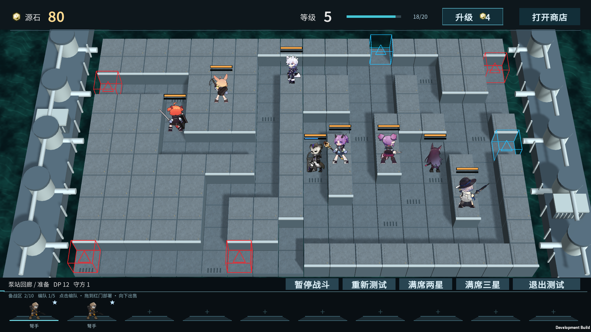
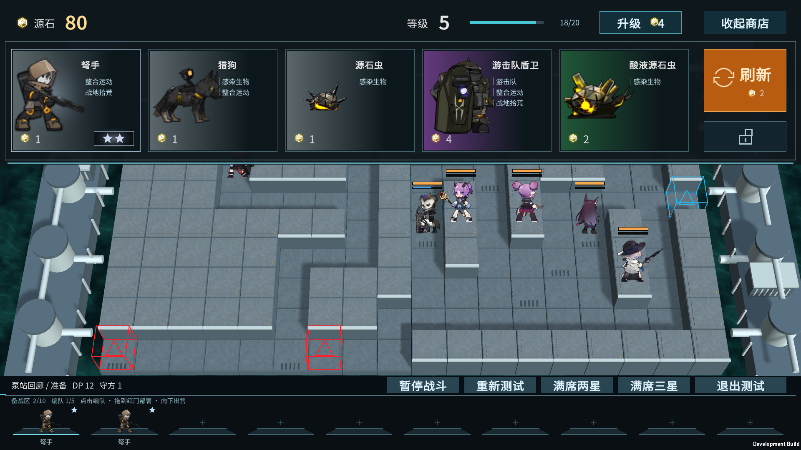
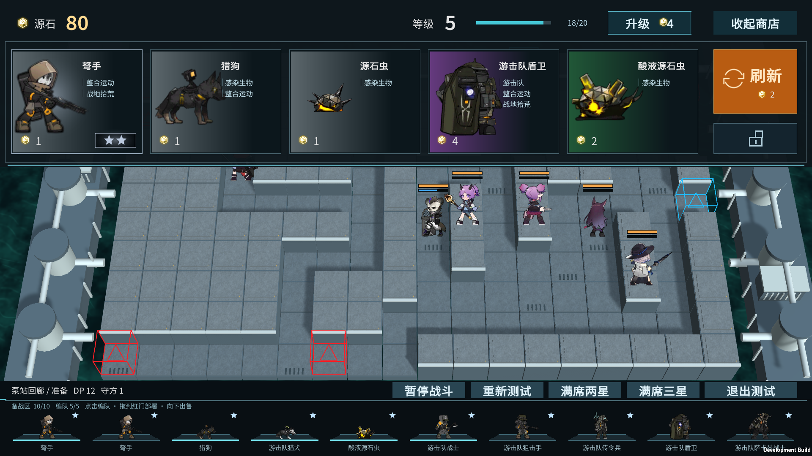
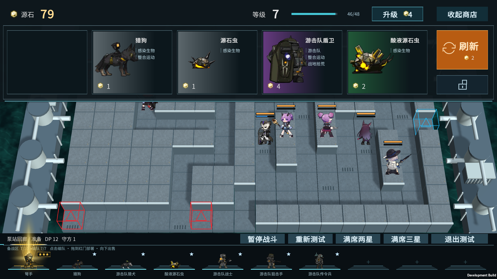
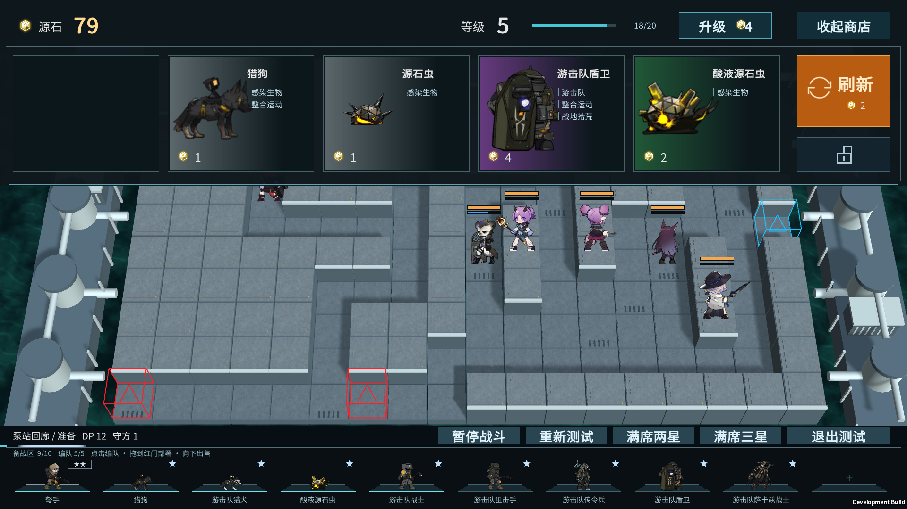
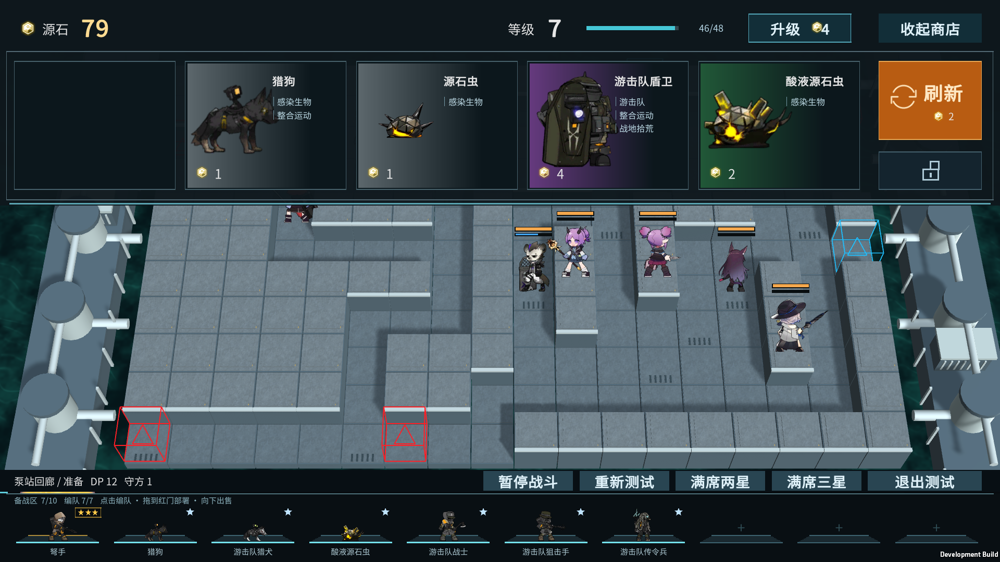
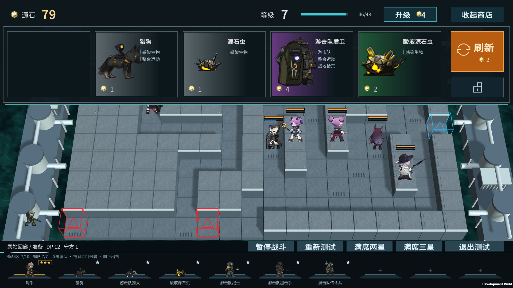

# 大地图、动态模型备战席与商店特效

2026-10-31 · 霍利屹 · [任务 #48](https://github.com/Peanora/YesterdayConvoy/issues/48) · [PR #47](https://github.com/Peanora/YesterdayConvoy/pull/47)

最新布局：地图占约75%屏幕高度，下沿10格备战席改为棋子站在台座上播放待机动作。商店默认收起，展开时从上方滑入、收起时滑回并淡出，不缩小或移动地图。保留已确认的商店卡片、羁绊标签、费用渐变色与右侧刷新/锁定排列，使用已有泵站回廊，地图格局和原俯视角度保持。

## 打开与操作

本机1920×1080试玩：`D:/游戏开发/YesterdayConvoy-ShopUI/Builds/ShopMap/YesterdayConvoy-Shop.exe`。保留完整ShopMap目录，不能只复制EXE。Unity 6000.6.5f1打开本分支的 `Assets/_Game/ShopTrials/ShopMap.unity` 点Play；重建Windows使用 `YesterdayConvoy.Editor.ShopMapTools.Build`，输出 `Builds/ShopMap`。

- 右上“打开商店/收起商店”或 **Tab** 切换；**Esc** 收起并取消拖动。展开约0.24秒、收起约0.18秒，快速反向切换从当前位置接续。开关不刷新、不扣款、不移动镜头，不重置棋子或战斗。过渡期间禁用移动中的交易按钮，覆盖区域继续拦截地图点击，完全收起后恢复；展开不自动暂停。
- 点商店角色图片购买。右下角预告买下这一张后的最终二星/三星：二星银色、三星金色，星标在固定位置闪烁，角色图标有对应银/金亮起光效；商店和备战席都没有旋转星星或旋转光弧。连锁三星直接显示金色三星；预告不占库存、不扣钱，源石不足时仍不能购买。
- 升级4源石换4XP，经验溢出保留；刷新2源石，锁店不刷新不扣费。羁绊目前是标签展示。
- 下沿是十个站立台座，显示实际SpriteRenderer模型对象和战斗待机帧，复用本作二维战斗模型，不是卡面缩略图；不新增三维网格。星级固定在台座右上、名字在脚下。点击切换编队；拖动时商店自动收起，再拖到红门部署，战斗自动开始。战斗后交易冻结，商店仍可开关查看。
- 购买成功后，棋子带青色光迹沿弧线进入对应台座，约0.48秒落位；合成牌飞向合成结果所在席位。扣款、库存与合成即时原子完成，动画不延迟逻辑，也不额外生成战斗实体；出售、再次合成或重新测试会清理失效的飞行模型。
- 备战角色向下拖入最下沿出售区，出现报价后松手。拖回、区外松手、Esc、失焦均取消；卡槽底部也有足够向下拖动空间。轻点或抖动不出售。
- “满席两星/满席三星”载入10格材料并展开商店。点击第一张弩手直接购买并合成，不弹确认，分别剩9格/7格，只扣一次；第二张猎狗不能合成时拒绝且不扣钱。
- 备战席的星标始终固定，不旋转、不闪烁。落位后升星反馈播放1秒：二星银光，三星向上迸出金色光柱、直射光芒和上浮金屑，随后恢复静态星级与台座。暂停也按真实时间结束；已有二/三星棋子不自动播放。不弹中央成功面板，也不显示成功文字。
- “重新测试”回默认材料和收起状态；“退出测试”回原怪物菜单并恢复镜头视口/FOV。

[商店开关慢放](ui-previews/shop/shop-toggle.webm) · [购买落位与三星金光慢放](ui-previews/shop/purchase-and-three-star.webm)。均为真实游戏画面，8fps编码便于观察，实际过渡请以试玩为准。

## 比例、连接与范围

虚拟坐标1280×720：地图从y64到602，高538（74.7%）；备战带y632到720，高88，台座交互区域高62，仍是扁平下沿。模型保留比例，脚底对齐台座。1920×1080时地图实际高807像素。商店展开只增加上层绘制和输入遮挡，镜头始终一致，不能把之前的小地图FOV放大倍数当成当前屏幕占比。

布局参考方舟战斗画面的大地图与下沿部署条，参照[实机画面](https://note.com/grsn_note/n/n33f60d3ce1fa)；备战模型台座和购买落位参考用户指定的卫戍协议方向，官方[盟约更新说明](https://ak.hypergryph.com/news/5114)可确认整备区交互定位，但未公布逐帧动效参数，本版时长与光迹为本项目制作。这不是逐像素复刻或原作UI提取。没有导入新的参考游戏UI贴图/动画，继续使用项目既有样式与素材。

`ShopTrialModel`计算交易；`ShopMapTrial`连接卡定义、编队、覆盖层与输入；`ShopBenchModels`维护动态棋子、购买落位、金光与开关过渡，使用隔离的透明预览相机，不向战斗模型增加单位或碰撞体；`ShopMapBootstrap`负责独立入口及Tab/Esc。所有商店点击共用同一原子事务，覆盖区域使用与地图输入相同的可用区域判断。运行时克隆地图asset，不写回Resources。未修改InitialDemo、原地图配置、Prefab、Packages或ProjectSettings。

仍是10种基础角色测试池（M02/M03/M05/M08、原生源石虫、M15～M19），非完整正式商店或羁绊章节。按角色种类编队，同种只加入一次；沿用原卡DP/生命/冷却/部署次数。星级影响库存、展示和出售，暂不增加战斗属性。未实现战后收入、通关XP、存档、完整高费卡池或复杂首领编队。售出1/2/3星到账c/3c−1/9c−1，返库1/3/9张，规则保持。

## 实际验证与交付

最新模型备战席：5/5地图GPU PlayMode（play-model-bench-final.xml）通过；之后仅调整拖动显示/图标绘制/预览录制，build-model-bench-delivery.log重建1495943851 bytes、0错误；player-model-bench-delivery.log共22项全True。已查看滑入、动态模型、购买飞行和三星金光画面；本页截图与四段短片更新到本版。下文为此前版本验证历史，不冒充本次完整重跑。细节与未测项见[QA](QA.md)。

最新全局取消旋转：build-no-rank-rotation.log构建1495930340 bytes、0错误；player-no-rank-rotation.log共20项通过，银/金商店预告截图与短片已全部重录。共用绘制中旋转逻辑已删除，商店和备战均无旋转。此次仅显示调整，未重复EditMode/GPU PlayMode。

最新备战静态星标修订：build-bench-static-stars.log构建1495931056 bytes、0错误；player-bench-static-stars.log共20项通过，三星合成瞬间截图已更新。仅显示调整，未重复完整测试；结束后的二/三星静态截图与上一版一致。

备战持续特效修复：4/4地图GPU PlayMode复测通过（play-bench-expiry.xml），二/三星合成特效立即启动，暂停等待1.1秒后结束且星级保留。Windows1495931056 bytes、0错误；独立Player原19项及新增benchEffectsExpire共20项通过。证据：build-bench-expiry.log、player-bench-expiry.log及player-bench-expiry截图。上面的银/金短片展示商店预告；备战静态结果看新增settled截图。

本轮完整278/278 EditMode（edit-rank.xml）与4/4定向GPU PlayMode（play-rank.xml）通过。验证预告反复读取不改棋子/钱/库存、2/3星预告匹配实际结果、无钱不能买、满席无确认一次合成、重复购买不重复扣款、购买/出售后预告更新；场景覆盖合成后反馈为空、覆盖层、实际部署和地图恢复。

最新构建和独立Player结果见[QA](QA.md)。证据目录 `D:/游戏开发/artifacts/shop-map/`：build-no-rank-rotation.log、player-no-rank-rotation.log及player-no-rank-rotation截图；此前edit-rank.xml、play-rank.xml为历史结果。[二星动态](ui-previews/shop/silver-rank.webm)、[三星动态](ui-previews/shop/gold-rank.webm)均已更新为取消全部旋转后的版本，各由16张连续实机帧按8fps合成，保留固定星标亮度变化和光晕，仅展示动态，不作精确计时或游戏帧率证明。旧完整74 PlayMode、Node7/7和浏览器检查是历史结果，本轮未重跑；浏览器目录仍保留v12确认/中央面板旧展示，不作为最新Unity行为。

本轮取消确认和成功弹窗是用户最新修订，已同步GDD第7节，覆盖旧文档的确认步骤。视觉参考[官方TFT商店动画及二/三星效果改进方向](https://followthefix.teamfighttactics.leagueoflegends.com/)；银/金光晕、轮廓及星标均由本项目GUI绘制，商店和备战席的旋转特效已全部删除，没有提取云顶特效贴图或音效。ShopPromotionEffects.cs和meta随源码提交，无新增外部运行媒体。

未测第二台电脑、全新克隆构建、长时压力与人类数值平衡。本机通过不代表接收端已验收；接收者需按上述入口验证开关商店、招募/合成/出售/部署与退出。

角色图片/动画复用已跟踪资源及meta；源石运行图 `Assets/StreamingAssets/ShopTrial/originium.png` 的来源、哈希和真实权利状态见[记录](ui-previews/shop/assets/originium-source.json)。没有新增外部运行依赖。不自动合并main、ZIP或Releases，构建与日志不入Git。
