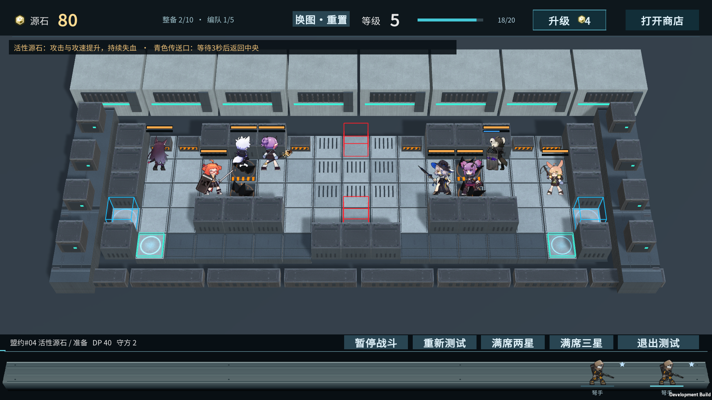
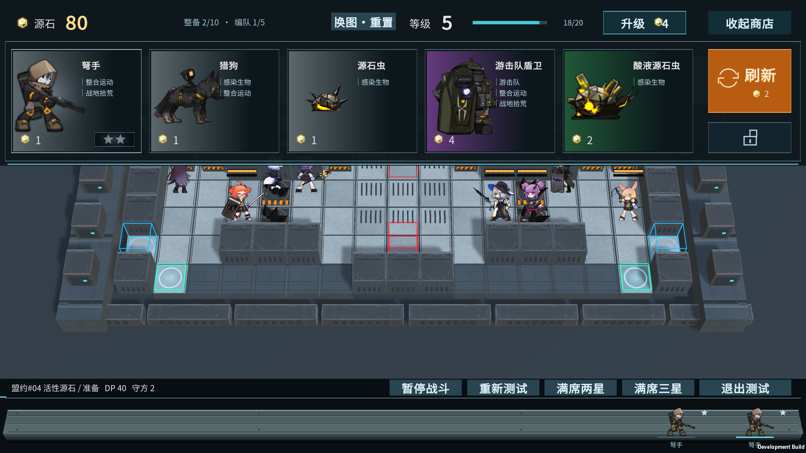
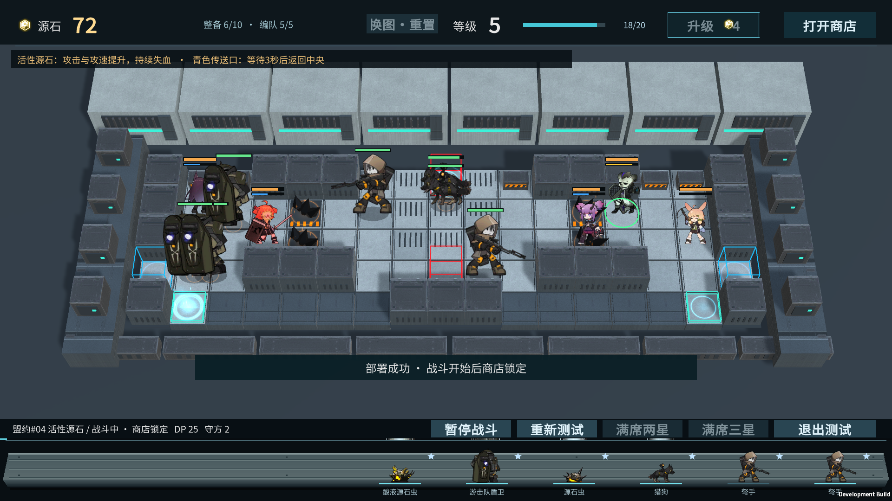
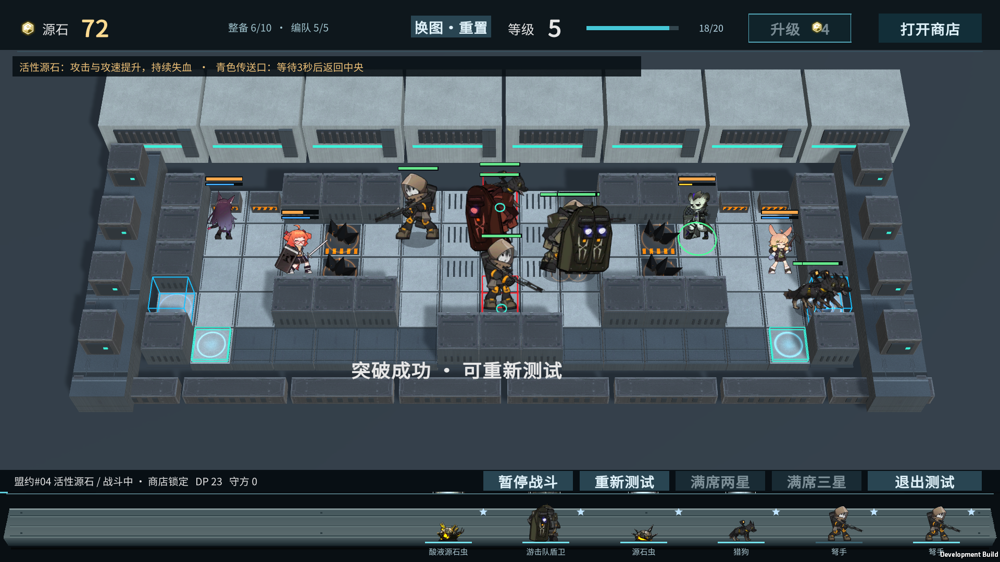
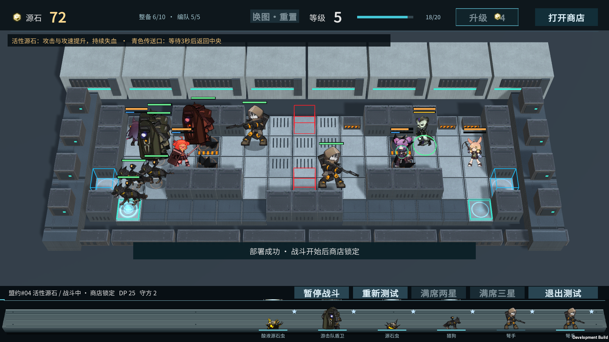

# 卫戍协议·盟约 #04：活性源石战场试玩

2026-10-31 · 霍利屹 · [任务 #49](https://github.com/Peanora/YesterdayConvoy/issues/49)

本轮按用户“从卫戍协议找真实复杂地图，并接进当前游戏试玩”的要求，采用**盟约战场#04的最终攻势左右合并战场**。实际地块来自原地图，地图外观使用本项目工业材质与新写的几何；角色、商店与长平台备战席沿用已有版本。

## 打开与操作

本机试玩：`D:/游戏开发/YesterdayConvoy-ShopUI/Builds/StrongholdMap/YesterdayConvoy-Stronghold.exe`，须保留完整目录。启动默认进入活性源石战场。

- Tab或右上按钮开关商店；点击图片购买。下方模型拖至中央上方/下方两个红门部署，沿红门指定路线进攻。
- 南门先穿右翼，再从右下青色口传送，返回中央上方后穿左翼，抵达西侧蓝门；北门先穿左翼，经左下青色口返回中央上方后穿右翼，抵达东侧蓝门。
- 青色口等待3秒模拟时间后出场，等待中模型隐藏、不能攻击或被选为守军目标；暂停时传送也暂停。源石持续伤害在传送中仍会结算。
- 四块橙色结晶地面是活性源石：进入后攻击和攻速各提升20%，每秒受到1点真实伤害，持续300秒，离开地块后仍保留。守军站在这些地块上也受影响。
- 升级、刷新、锁定、点击编队、向下出售、满席直接合成继续可用；战斗后交易锁定。星级仍只影响商店/展示/出售，不改变战斗属性。
- “重新测试”在当前地图重开；顶部“换图·重置”在准备/结算时切换到泵站回廊并重置本次准备；战斗中不能切图。“退出测试”回原怪物菜单。

本图采用独立试验预算：40DP、蓝门共用2点防御、各卡8次部署机会、怪物生命为原配置4倍；花费/CD/移动/攻击等沿用各卡。源石扣血按本项目量级改为1点/秒，原作是70点/秒；攻速在本项目以原有攻击速率乘1.2近似，非原作全部攻速叠加公式。参数是可玩性试验，不修改角色原资产、不声称原作平衡。








## 地图材质与动态特效

地面接入混凝土纹理，工事/设备接入2K金属图集与匹配法线，增加顶盖紧固点、通风格栅、警戒斜纹、管线和接地层次。源石使用深色多面晶体配橙色能量，保持四块原地形位置。

源石有地面脉冲和上升碎光；感染单位/守军有橙色脚环；传送口有青色呼吸环，实际等待时亮起光柱和能量，出场时扩散闪光，突破蓝门也有短暂蓝光。准备时活动、战斗时跟随模拟时钟，暂停冻结，重开和切图清理。光效集中在一张动态网格中，不额外创建战斗单位。

[源石动态预览](ui-previews/stronghold04/source-effects.webm) · [传送等待与出场预览](ui-previews/stronghold04/portal-effects.webm)。均来自连续实机截图，8fps编码便于观察，不作为游戏帧率或精确计时证明。

贴图来自项目已有CC0资源，文件像素与原导入设置不变；本轮无新下载、AI贴图或原作特效素材。Shader、几何和光效代码为本项目新增。[作者、许可、逐文件哈希和表现边界](art/STRONGHOLD_MAP_MATERIALS.md)。

## 为什么选这张

原地图有左右两翼、中心连接、上下封闭工事、两侧目标与传送入口；活性源石夹在翼内横向通道，绕行时会把增伤与失血带往下一段。原地块保留5行×17列（原坐标行5～1、列2～18），不把整备区、敌人预览区等也算成作战面积。

下表是原地块转录，自上向下；`#`封闭、`.`普通地面、`h`可部署地面、`x`不可部署通道、`a`活性源石、`O`中央传送出口、`E`目标、`I`传送入口、`b`原作手牌区域。

```text
#h.###.xOx.###.h#
#h..a..xxx..a..h#
#h..a..xxx..a..h#
E..###..O..###..E
#Ibbbbb###bbbbbI#
```

本作将中央两个出口用作进攻部署起点，左右入口作为传送段，左右E作为蓝门；两条地面绕行路线为本作按这些实际可行走格点编排，保留六处固定工事位置并绕开。**并非原作飞行Boss路线、所有寻径、可移动/可破坏工事或完整卫戍协议规则的逐项复刻。** 原作某些Boss的N形飞行路线不能直接用于本作地面怪物，否则会穿过封闭地块。

原作已有单人/联机与多回合数据，本版仍是《昨日圆车》玩家部署怪物进攻守军的独立战斗，不包含原作联机、敌人轮次生成、盟约叠层、装备和全部Boss。胜负按本作：突破累计2次胜利；无存活单位且所有可部署费用/次数耗尽失败。

## 来源、数据核对与素材

- [PRTS：卫戍协议·盟约/战场一览 #04](https://prts.wiki/w/卫戍协议：盟约/战场一览#%2304)：确认地图编号和活性源石机制。
- 客户端数据镜像固定提交 `a24a8ad150e1dd7a9c2e2944e48997145eccac11`：[地块及预置工事](https://github.com/Kengxxiao/ArknightsGameData/blob/a24a8ad150e1dd7a9c2e2944e48997145eccac11/zh_CN/gamedata/levels/activities/act1autochess/level_act1autochess_m04.json)，[最终攻势路线](https://github.com/Kengxxiao/ArknightsGameData/blob/a24a8ad150e1dd7a9c2e2944e48997145eccac11/zh_CN/gamedata/levels/activities/act1autochess/level_act1autochess_h07_04.json)。两文件与读取的master版本逐字节相同。
- 地块原文件SHA256：`0e177b8b5607c185defe9e178e6b660528c069f0794f1fdd8a3869ade6f8289c`；路线原文件：`2f16ba87aeb562dbe8e284c2b83471c58ae6c00e14d8872ee8d8c1481df6924c`。

原作名称和地图规则归原权利人；数据镜像公开可读不等于原作美术开放授权。原始JSON留本地研究目录，仅转录实现所需地块事实和参数；没有导入或提交原地图模型、贴图、截图、音乐、UI或原始关卡JSON。新的平台/工事/晶体/门线为本项目代码几何，运行所用角色、地面纹理与meta均复用已跟踪文件，不新增远程运行依赖。既有角色素材的真实权利状态沿用项目记录。

## 实现和验证

`StrongholdMapLayout`转录地块、创建运行时独立配置；`StrongholdMapEnvironment`搭建工业环境并显示分段路线；`StrongholdMapEffects`在战斗模型内处理传送和感染，遵守暂停/重开；控制器仅在本图应用预算倍率并清理过渡模型。原主场景、原两张地图asset、Prefab、Packages和ProjectSettings保持。

Unity6000.6.5f1打开`Assets/_Game/ShopTrials/ShopMap.unity`点Play；`YesterdayConvoy.Editor.StrongholdMapTools.Build`重建Windows至`Builds/StrongholdMap`。旧商店Smoke命令仍载入泵站图，新图用`-strongholdMapSmokeTest`，日志/截图由`-demoEvidenceDir`指定。

实际通过：完整283/283 EditMode、8/8定向GPU PlayMode；Windows构建1495965600 bytes、0错误。新图13项、旧图23项独立Player检查全True。测试编队在30.85秒模拟时间内完成2次突破、7次传送和9次感染触发；另用逻辑测试验证耗尽失败/重开。四张画面为最终构建实际截图。证据文件见[QA](QA.md)。未在第二台电脑或全新克隆构建验收，不把本机成功等同于接收端已验收。

最新材质/特效交付：play-stronghold-polish.xml的9项定向GPU场景测试通过；其后仅补自动验收后台启动与结算闪光收尾，最终build-stronghold-polish-delivery.log重建1496034691 bytes、0错误，player-stronghold-polish-delivery.log的13项玩法和5项视觉检查共18项全True。新编队模拟30.89秒获胜，7次传送和9次感染触发。已复核最终材质画面并更新5张实机图与两段短片。前述283完整逻辑及旧图23项为前一版记录，本轮未重跑。
