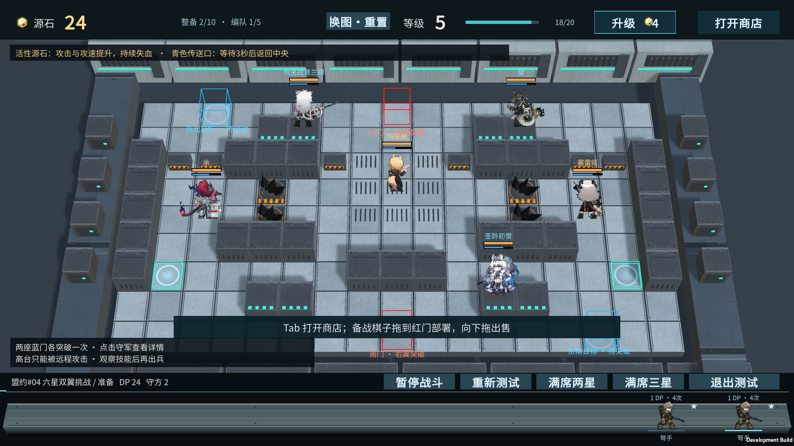
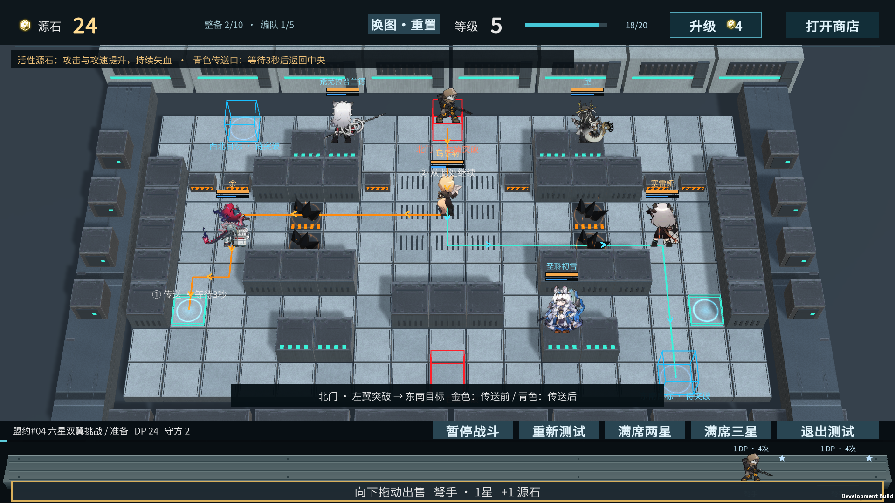
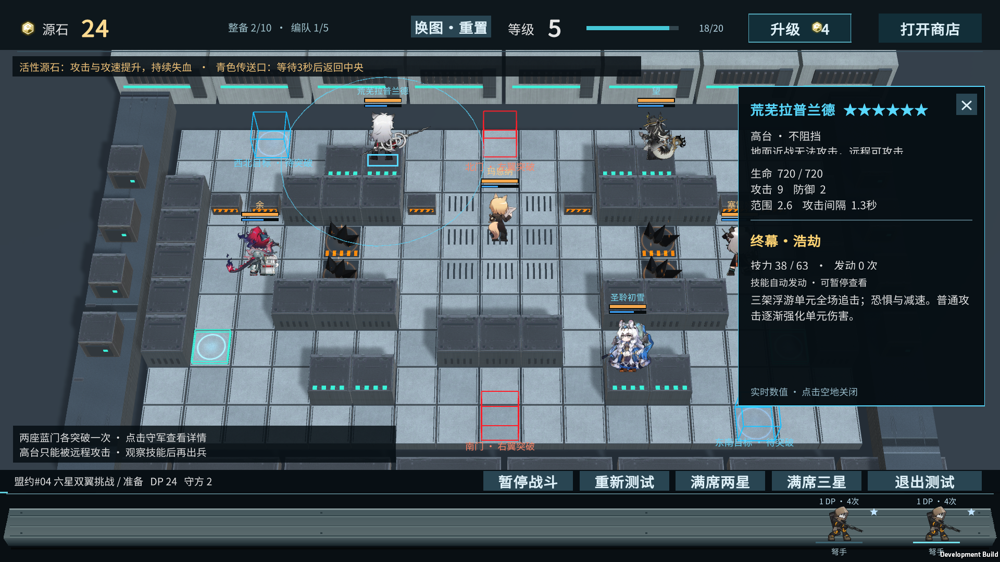
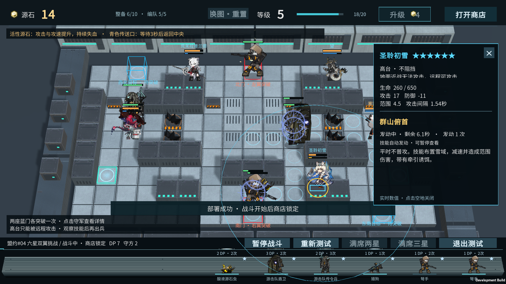
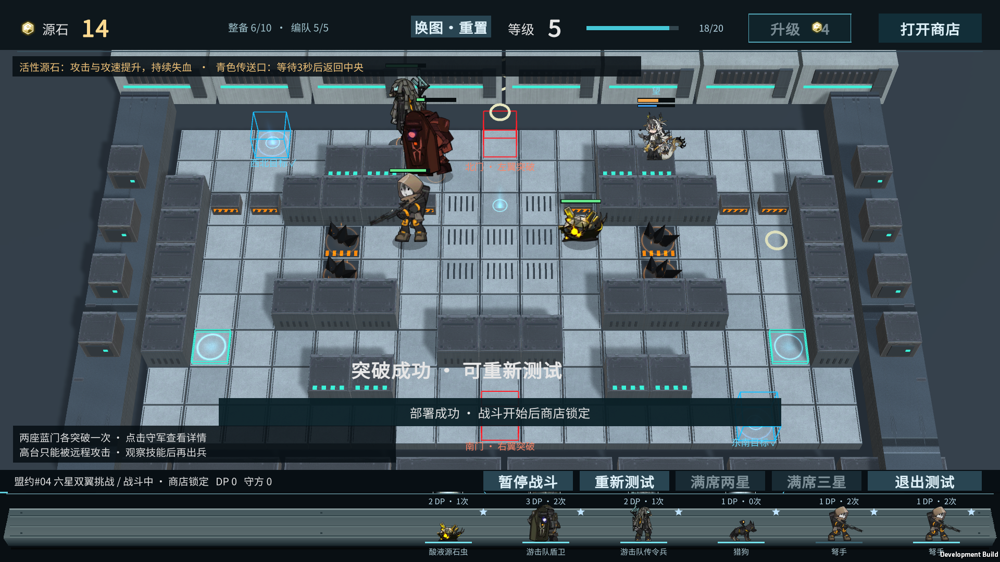

# 六星双翼挑战：试玩与验收

2026-11-01 · 霍利屹 · 继续任务 #49 / PR #50。

这次把已经完成模型与所选技能的六名六星干员编进防线，将盟约#04适配图从5行扩展到9行。**这是本作挑战扩建版，新增上下区域不是原作地图的真实转录。** 原5×17版本和泵站回廊继续保留，可以切换。

## 如何试玩

本机入口：`D:/游戏开发/YesterdayConvoy-ShopUI/Builds/StrongholdMap/YesterdayConvoy-Stronghold.exe`，保留整个目录。Unity入口仍是 `Assets/_Game/ShopTrials/ShopMap.unity`，编辑器6000.6.5f1，点Play默认进入挑战版。

1. 先点击六星守军，查看实时生命/上限、攻击、防御、范围、攻击间隔、技能说明、技力与发动状态；望显示弹药/储棋，玛恩纳显示蓄力。空地或×关闭；可暂停研究。
2. Tab打开商店，点击图片购买；下方模型拖到红门出兵。首次合法部署开始战斗，之后持续计时，商店交易锁定。准备时备战棋子轻点调整编队，向下拖出售。
3. 拖动到任一红门时显示整条路线与箭头：金色是传送前，青色是传送后；①传送入口等待3秒，②中央继续进攻。传送连接不会画成可步行的桥。离开红门或取消拖动隐藏路线。
4. **西北与东南两个蓝门各突破一次才算通关。** 已突破目标带✓；重复进入同一个目标不能扣掉另一座目标的防御。
5. Space或“暂停战斗”暂停，再按继续。重新测试重置本图；顶部换图依次为挑战版→泵站→原5行盟约图→挑战版。战斗中不能切图。

挑战预算：准备资金24源石，等级5、编队上限5（升级仍可增加）；部署费用另计，共24DP，每个种类4次部署，怪物生命按原配置×3.6。开局商店给出弩手、猎狗、游击队传令兵、盾卫、酸液源石虫，避免参考打法依赖刷新运气。原图仍用原40DP/8次/×4试验参数；原角色asset没有被覆盖。

备战上沿显示每种已编队怪物的部署费用、共享剩余次数和冷却。相同种类多个备战棋子共享该卡部署次数；升星仍沿用当前商店的视觉/交易规则，**不增加战斗属性**。

## 防线与地形

| 干员 | 地形 | 本图生命 / 攻击 / 防御 | 已接入的所选技能 | 需要观察的威胁 |
| --- | --- | --- | --- | --- |
| 荒芜拉普兰德 D21 | 高台 | 720 / 9 / 2 | 终幕·浩劫 | 全场浮游单元追击、恐惧和减速 |
| 余 D22 | 地面 | 1100 / 16 / 12 | 灶里乾坤 | 阻挡、火墙、强化与回复 |
| 圣聆初雪 D27 | 高台 | 650 / 10 / 3 | 群山俯首 | 雪域范围伤害、减速和诱饵 |
| 望 D28 | 高台 | 720 / 10 / 4 | 天下劫 | 棋子连锁、弹药和陷阱 |
| 塞雷娅 D29 | 地面 | 900 / 24 / 10 | 钙质化 | 群体治疗、减速、法术易伤 |
| 玛恩纳 D30 | 地面 | 950 / 12 / 10 | 未照耀的荣光 | 平时蓄力不攻击/不阻挡，开启后范围爆发 |

表内是本图基础值；实时值可能被技能、感染或减防改变，实际看点击面板。塞雷娅攻击力同时用于治疗，并不表示每次都进行伤害攻击。

角色头顶名牌只显示名字，不追加“高台/地面”。高台为实际抬高约0.72的金属平台，青色边缘提示；三名高台守军不阻挡，地面近战无法选中攻击，远程可以攻击。地面守军按各自阻挡/技能状态拦截。两条地面路径均避开墙、高台和原六处固定路障；原底部工事行在本扩建版改为维护通道。原四块源石与两侧传送口保留，其感染和3秒等待规则见[原地图说明](STRONGHOLD_MAP_04.md)。

技能逻辑与模型复用既有角色，运行时深复制并调整本图基础数值/站位；不是六名干员的全技能、全部天赋和模组复刻。具体原有适配边界见[第四批](DEFENDER-SKILLS-BATCH4.md)、[第六批](DEFENDER-SKILLS-BATCH6.md)。

## 难度验证

使用真实ManualBattle、角色技能和部署事务模拟，未清空守军、强改生命或跳过传送。180个受限固定脚本样本中6个完成双目标，其余包括失败和仍未完成；这些样本不能换算成人类胜率。四次猎狗、弩手或盾卫的单兵种测试均未通关；将参考混合编队全部改为同一红门也不能完成双目标。

保存的参考方案在两侧交替进攻，利用先遣单位与后续波次的时间差，14次实际部署，126.35秒完成双目标，剩余0DP；六名干员均实际发动技能。后续波次整体提前或延后一秒仍能通关，避免要求逐帧精准。参考只证明至少一个可行解，最终“是否有趣、是否勉强过关”仍需人工试玩反馈。

需要提示时再看：参考出兵表（战斗开始后秒数）

准备时购买其余四个不同种类，形成弩手/猎狗/传令兵/盾卫/酸液五种编队，先遣部署立即开始计时。

| 时间 | 棋子 | 红门 |
| --- | --- | --- |
| 0 | 酸液源石虫 | 北 |
| 47 | 猎狗 | 南 |
| 49 | 猎狗 | 北 |
| 51 | 盾卫 | 南 |
| 53 | 传令兵 | 北 |
| 55 | 盾卫 | 南 |
| 57 | 猎狗 | 北 |
| 59 | 酸液源石虫 | 南 |
| 61 | 弩手 | 北 |
| 63 | 弩手 | 南 |
| 83 | 猎狗 | 南 |
| 87 | 酸液源石虫 | 南 |
| 91 | 传令兵 | 南 |
| 95 | 传令兵 | 南 |

验收通过真实备战席拖动重放这些操作，单人手动可以暂停选牌，不必追求每帧相同。重放数据随源码保存在StrongholdChallengeSolution.json。

## 文件、来源和交接

新增布局、实机验收、详情面板、模拟方案/Editor平衡工具、逻辑与场景测试及必要.meta；复用已有ShopMap独立场景。没有修改InitialDemo、旧地图asset、共享Prefab、Packages或ProjectSettings，也没有取消.gitignore规则。初始已存在的.vscode保留未跟踪。

没有新增下载、提取或再分发原作素材。六名角色图集沿用仓库已接入版本；其原有来源与权利记录继续适用，本轮不将它们重新声称为CC0。环境仍复用已有混凝土和金属/法线，[材质作者与许可](art/STRONGHOLD_MAP_MATERIALS.md)保持。没有新增运行时网络依赖或需另行交接的本轮素材。

Editor构建方法：`YesterdayConvoy.Editor.StrongholdMapTools.Build`。自动实机验收参数：`-strongholdChallengeSmokeTest -demoEvidenceDir <截图目录>`。原图参数仍为`-strongholdMapSmokeTest`，旧泵站为`-shopMapSmokeTest`。平衡工具`StrongholdChallengeTools.Balance`会重新写入参考方案，改数值后应重新验收再提交。

完整测试结果与限制见[QA](QA.md)。本机成功不等于第二台电脑或全新克隆已验收；未完成完整回合制、羁绊、装备或联机。本功能沿用依赖未合并PR #47的PR #50，不自动合并main或发布ZIP。

## 实际Player截图

