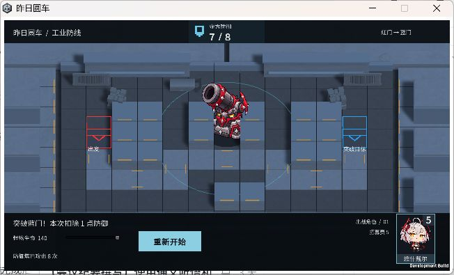
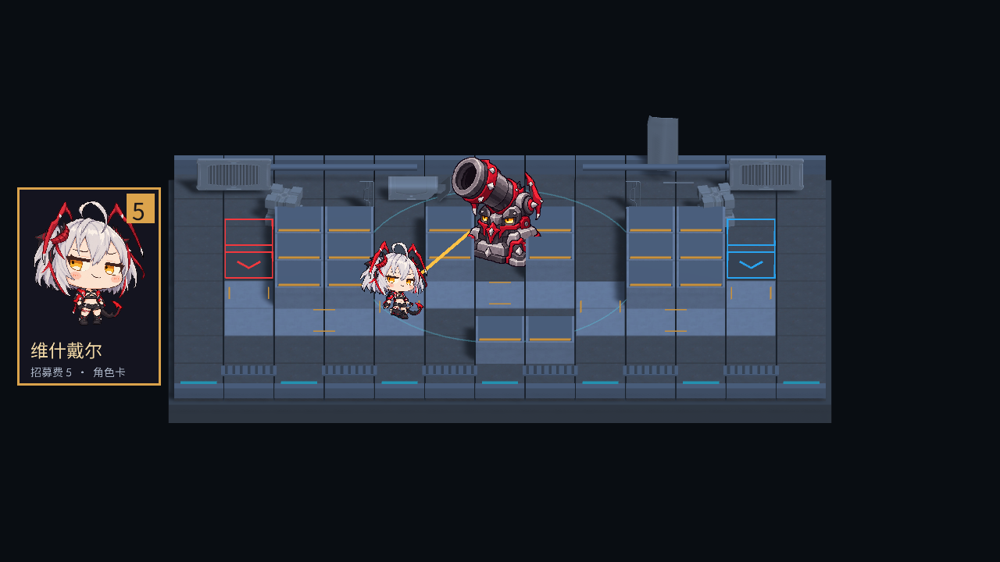

# 美术路线 V1.1

## 当前统一美术方向：用户提供的夸张漫画Q版（2026-10-19）

用户明确“以后全游戏的美术风格都按这个来”，以本次四个维什戴尔GIF为代表：大头短身、粗黑轮廓、干净平涂、有限阴影、夸张眼神/表情和漫画式肢体动作。**覆盖旧AI像素感/蔑视表情版本作为新资源基准的约定**，不继续混用像素点阵、写实卡面与不同粗细的角色线条。卡牌和战斗造型保持同一系列；不是要求所有角色换成同一张脸或同一种红黑配色。新角色仍由用户指定。

本次映射：GIF1走路19帧/0.95秒；GIF2首帧静态卡面与待机（不播放原23帧待机）；GIF3普攻28帧/1.4秒；GIF4爆裂黎明100帧，完整姿势适配现有3.2秒技能攻击间隔（源5秒）。统一原生像素比例与PPU173.333，走路/攻击/技能各自固定脚底坐标，保留源帧的摆动和翻滚，不逐帧裁切居中、不强行拉伸。平涂非像素图采用Bilinear；真实透明背景，不能把显示器黑底烘焙进去。

正常交战停用旧纸片关节、方向翻转和转身过渡，所有路径方向都播放同一套正面帧；相机朝向对齐只是纸片在3D地图中正确显示，不是角色转身。动作与特效读取统一模拟时钟，暂停冻结；普通攻击播放后末帧停留至下次攻击，技能前摇先保持首帧，实际开火才推进，不因换美术改变伤害/弹药时机。

同日用户补充与最新澄清：一次已发射的技能攻击动作必须独立播完，目标死亡不能打断；播放期间角色必须停在原地，禁止只播放动作却继续位移，播完后才按当前索敌/阻挡恢复移动。动作与逻辑共用战斗模型的动作窗口，自身离场仍清理，暂停仍冻结。爆炸表情大头为原1.75倍试验值，只调特效大小，不缩放人物/碰撞/攻击范围。

特效方向：黑色外轮廓、黄白/红色少量大色块、锯齿爆炸、短促闪光和表情印章；不堆写实烟火、霓虹或遮挡信息的全屏效果。本轮表情印章从用户第四个GIF固定区域裁出，六个取样并非六张完全不同的独立原创表情；不声称复刻原作全部特效。现有蓝色技力/黄色弹药、红蓝门与简洁HUD的信息语义保留。

地图仍保持用户固定的《明日方舟》正向斜俯视战术几何、模块方格与高低台；未来环境美术也需减少细碎写实噪声，向清晰色块与角色的线条密度靠拢。本轮没有重绘整张地图、克洛丝或全套UI，不把“统一方向已定”写成“全游戏资源已替换”。镜头/路线/数值不因素材改变。

来源/权利/联网检索结果见[本轮资源记录](WISADEL-COMIC-2026-10-19.md)，逐帧文件与原GIF哈希见source-records/wisadel-comic.json。用户供图授权本地修改不等于取得商业游戏美术公开再分发许可；本轮仅本地提交，不推送/发布。

## 技能交互表现（2026-10-19）

复用深蓝灰面板、白色文字与金色就绪强调，角色旁展示技能图标、SP/弹药和实例编号；头顶金色图标配“就绪”，不只依赖颜色。图标为已登记的Lorc CC BY3.0 magic-swirl，保留署名。打开面板稍压暗战场；0.03×为体验试验值，完全暂停优先。卡牌/UI保留可编辑组件，地图/角色画风与当前镜头不因该交互改变。

## 最新镜头修订（2026-10-19，相机反馈）

用户要求屏幕倾斜程度也按参考图调整。当前从52°正交切换为60°俯角轻透视、垂直FOV24°、距观察点24，观察点(0,0,0.7)，偏航/滚转仍0；前排略大、后排略小，顶面更充分。以下旧52°/正交规格是之前样板记录，不再作为当前生成器默认值。当前参数是按截图估计的试验值，不称为原作精确配置；项目保留16:9，原图20:9的裁切比例不会完全重合。

只调整相机/视觉对齐，角色比例/脚底、地图结构与战斗参数不变。已实机查看与15项GPU/构建/Player检查，见STATUS/QA与previews/waterworks-camera-v2.png。

## 2026-10-19参考截图的落实方式

用户提供明日方舟实机截图，固定借鉴：可读的逐格平台、平台边缘/立面、高低台材质分工、路线与背景的明暗层次、外围建筑和水域围合。图片仅供观察，不复制原游戏地图像素、角色/标识或具体布局。当前选“废弃水闸检修平台”作为实现样板，沿既定现代工业方向，不把参考图的幻想遗迹装饰直接混入。

技术保持XZ地面、52°正交俯视/左右偏航0/尺寸4.9、原路线。值域：路线较亮、普通地面中灰、高台深灰、外围深青；红蓝入口继续最醒目。高台用四边细框、嵌板与有限角件打断原连续蓝条；黄条只在少量入口/管线安全标识出现。混凝土/金属贴图复用原CC0资源，水面用原创静态世界空间噪声Shader，不引入时间动画。

此样板已在Player中检查；后续仍需要专用建筑造型与道具密度的细化。测试通过不等于主观风格验收，人类反馈优先。

## 地图固定方向（2026-10-18，人类已确认，覆盖旧地图候选）

**地图必须与《明日方舟》的视觉风格相近，不得随意选风格。** 固定正向斜俯视 2.5D、水平棋盘横边、清晰方格/高度层级，低饱和蓝灰/混凝土/金属的现代城市与工业设施语言，克制磨损与少量警戒线。路径、角色和红蓝入口比装饰更醒目；不以密集霓虹、魔法石墙、城堡地牢、像素平台替代。现有怪物/卡面保留人类认可版本，地图不再受旧石板/符文门的幻想题材约束。

本次试样主题：城区工业检修场地；后续环境题材可变，但地图的镜头、模块尺度、灰阶层级和战术可读性不能脱离上述参照。网站素材先核具体内容及许可，再统一材质/颜色后使用，不因来自同站就默认一致。原作截图只作研究参照，不进入可分发资源目录。历史的“地牢/中世纪/完整像素方案”地图建议失效。

最新布局要求：地图延展到画面四边，上方保留小型防御标志与实时数值，下方放角色栏；取消左侧大卡牌和黑底托盘式构图。提高俯角以展开地面纵深，保持左右偏航/滚转为 0。当前相机试验值 52°、正交尺寸 4.9，并非人类批准的唯一精确角度。

当前图包含实际顶部防御与底部角色栏。环境采用统一混凝土/钢结构灰阶、克制暖色边线；旧导入墙/栏杆轮廓停用，认可角色保留，并加接地阴影。技术验证范围见 QA，最终风格仍待用户反馈。

首张样板反馈：设备/地面层次不协调，俯角不足、四周留黑太多。下图保留为首版历史对照，不能作为已认可的最终构图。

上图为本项目实际相机截图（不含 OnGUI 操作栏），技术导入与进攻回归已通过；本张样板是否足够接近目标仍待人类观感验收，不把它当作已批准的最终美术。

## 当前已确认的 Demo 方向（覆盖下方旧候选建议）

最新人类要求：**向右行走保持原来的三分之四正面姿态，不用纯侧身**。右向常态使用原正面裁片和原横向站位，半速与向下步态修正保留；侧面、斜背面只作为转角过程的中间方向，不要求常态侧行。此条覆盖下面上一轮“侧面加入四方向”的常态选图方式。

2026-10-17，用户认可维什戴尔愚人节形象的 AI 蔑视表情版本，要求原样保存为 5 费卡，并用同风格生成并替换当前实机。当前基准为**有趣、夸张大头、像素感轮廓、银灰/炭黑/红色、半眯眼蔑视表情**；门保留红蓝辨识，棋盘仍为斜俯视 2.5D。当前不再以“非像素优先”约束这次明确授权的美术。正式更多角色与热梗题材尚未选择。

卡面保存用户认可的原图，战场用另生成的简化 Sprite；每个对象按有效像素包围盒与世界高度计算 PPU 和脚底 Pivot。当前单角色采用正背面图的网格分区关节动画，不称为精确低分辨率逐帧像素动画或完整多方向专业骨骼素材。5 费记录为招募费，不代表已经实现消费事务、部署费用或首领技能。生成记录与使用范围见 GENERATION-2026-10-17.md。

2026-10-17 用户要求镜头回正：**左右偏航与滚转为 0，棋盘横边水平，保留下俯角和地面厚度**。用户继续反馈动作与转身：当前 U01 已按明确指令把实际速度与步频减半（moveSpeed=0.75、Stride=0.64），纵深步幅缩短、双脚统一落地基准。新右侧面与斜背面图加入原正背面，形成四套裁片 Rig；约 0.38 秒的转向中头先转、身体跟随、脚部换步，不再压扁或透明叠化。反复起停平滑过渡，腿部伸长上限 4%，暂停冻结、重开复位。图间造型差异和裁片接缝仍存在，完整独立部件与遮挡补绘仍缺，不以自动测试宣称主观自然程度已获认可。目标与后续计划见 ANIMATION_PLAN.md。

## 首次调查候选（历史）

日期：2026-10-17。范围：Phase 1–3 与少量 Phase 4。用户再次确认：**斜俯视、2.5D，类似《明日方舟》**。任务书中的横版侧视不作为当前选型条件。不复制商业游戏角色、地图或 UI。

## 首次调查的推荐与取舍（历史，地图建议已失效）

以下仅保留首次调查记录，不能据此更换已经固定的《明日方舟》相近地图方向。

首选保留现有非像素 2.5D 棋盘，朝“暗色幻想、冷色石质废弃防线、清晰角色剪影、简洁深色 UI”推进。使用同一批图标、字体、粒子与音效；角色统一系列尚未锁定，先做两种角色的流程样张，再决定是否扩充。**目前没有找到无需额外制作就覆盖全部需求的免费非像素体系**，不能把几个网站的不同风格拼起来称为完整方案。

非像素最接近的现成路线：GameArt2D 免费 Knight / Zombie 系列，有现成 PNG 动作序列；Kenney Isometric Miniature Dungeon 有同系列石墙和地面。但前者侧身大头卡通、后者等距预渲染，不能直接认定视角与风格兼容。需要两角色试样及低饱和度改色，当前仅候选，未覆盖现有场景。

省工备选：**0x72 DungeonTileset II**。实际下载 v1.7，压缩包有 370 张独立 PNG 图块/帧，其中包含 25 个 idle/run 命名角色前缀及额外简易动画生物。可由同一包选四普通、一精英、一首领、三守军及地牢地图；职业对应仅是美术建议，不修改角色规则。它能显著减少角色与地图搜集工时，但缺少大部分完整攻击/死亡动作和精致卡面，且 16px 像素需要整体采用 Point 风格。若选它，地图、角色、特效和 UI 装饰都需同步统一，不能直接把它与 Kenney 非像素角色混用。

| 比较 | 非像素主路线 | 0x72 像素备选 |
| --- | --- | --- |
| 当前棋盘延续 | 高，保留立体地面；环境贴图仍需匹配投影 | 中，需要重新测试地面与 Sprite 的视角关系 |
| 同系列角色覆盖 | 不足，免费现成角色不足以承诺 P0 全覆盖 | 高，已检查角色与图块文件；尚未做 Unity 角色验证 |
| 动画 | GameArt2D 有序列；混系列风险高 | idle/run 多，攻击/死亡主要靠武器位移、受击闪色与渐隐 |
| 卡面 | 需要统一原创立绘或额外资源 | 可先统一像素放大展示，精致非像素卡面不能无规划混入 |
| 手工工作 | 角色补齐、改色、脚底与镜头匹配较多 | 比例/方向/Point 渲染、伪动画和 UI 适配 |
| 本轮选择状态 | 推荐方向；主角色仍有缺口 | 完整省工备选；尚未授权改现有画面 |

## 暂定规范

- 背景/面板 `#151A22`；石地 `#414B59`；主要文字 `#D8E1EA`。我方标记青绿 `#62C6B3`、守方威胁偏琥珀 `#DCA268`，出生红门与目标蓝门保留，颜色之外配形状/图标。
- 1920×1080 是后续设计参考；当前 Demo 实际 1280×720，本轮不更改窗口或镜头。
- XZ 为地面，角色 Sprite 采用面向相机的直立平面是待验证方案，脚底中心 Pivot；禁止把预渲染等距图直接铺到倾斜地面造成二次透视。转弯方向、背向动作是否缺失必须实测。
- 非像素战斗小人目标约 96–128px 可见高度，精英 128–160、首领 192–256；128 PPU 为将来角色候选约定，源图像素/可见高度和每帧画布需先核实，当前不强设所有图相同 PPU。
- 已导入图标统一 256×256 透明白底图形，256 PPU、Bilinear、Clamp、无 mipmap；由 UI 着色。羁绊展示可用 128px，保留 256px 源。四个羁绊图形只是美术占位，不新增羁绊规则。
- 角色和地图未选定前不配置新 Sorting Layer 或 Atlas。未来顺序为地面→地面标记→脚底阴影→角色→特效→世界血条→HUD；XZ 深度与透明排序必须在真实镜头中验证，不能只靠层名保证正确。
- 卡面 3:4、目标 768×1024；立绘无文字，费用/星级/多羁绊/次数/CD 由 Unity UI 叠加。首领用尺寸、轮廓、前摇和边框识别，不设计首领数量限制。
- 不做强制倒计时、不做自然回费进度条。首领技能 CD 与部署 CD 各自表达，多个羁绊同时可见。

实际资源、许可与取舍见 [ASSET_SOURCES](ASSET_SOURCES.md)，导入验证范围见 [ART_PROGRESS](ART_PROGRESS.md)。
