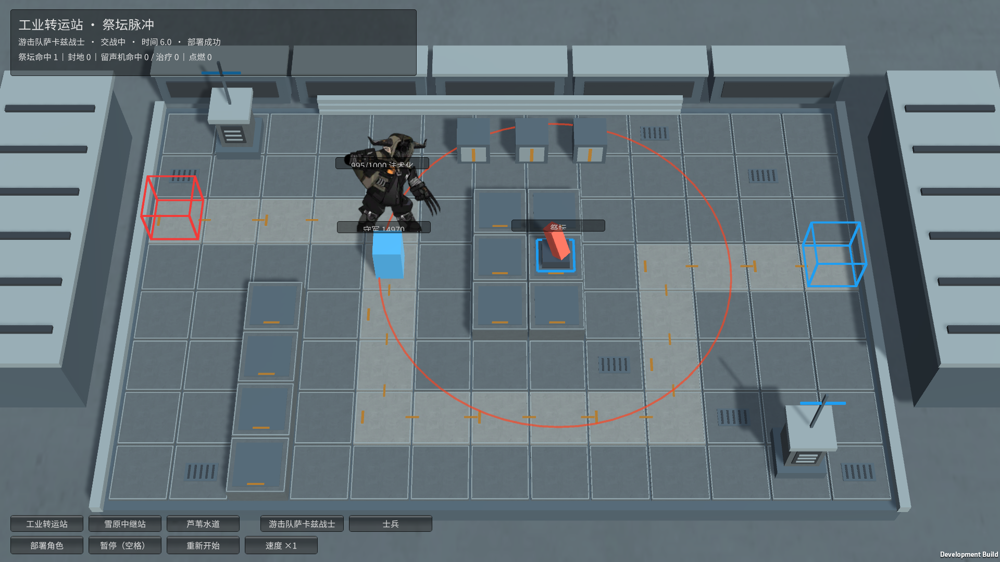
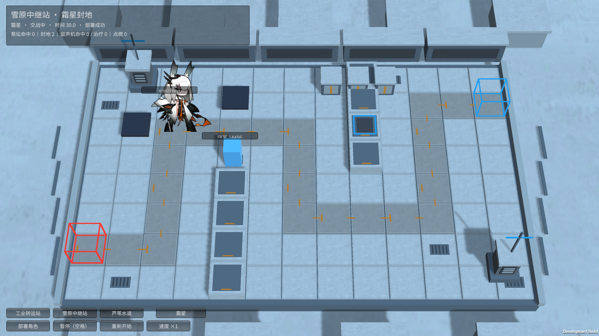
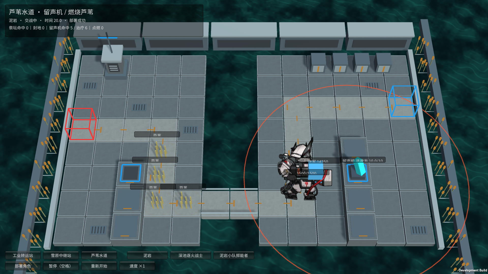
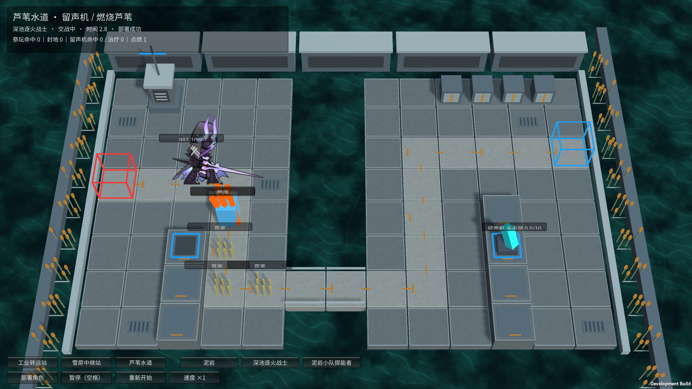

# 已确认地图的设施效果试玩

2026-10-24，霍利屹 / Codex；任务 #24。用户确认三张地图后制作这一批设施与关联角色效果。独立分支 `codex/map-facility-effects`，整合 PR #21 已提交的角色能力与 PR #23 地图；旧角色工作区未提交的 M29 方阵战士继续保留，未混入。

**2026-10-25角色续作纠正：** M29已验证保存；M30原作是靠近燃烧芦苇时攻击附加灼燃，不是自动点燃。后续角色分支删除M30自动点火，水道M30试玩改用地图预置起火点，并加入余烬、重生与反隐开关。以下“点燃”Player结果是上一批的历史记录，当前机制和新验证见[M30交付](../monsters/M30-FLAMECHASER-EFFECTS.md)。

## 怎么玩

使用 Unity **6000.6.5f1**。打开 `Assets/_Game/FacilityTrials/` 下任一场景，点击运行；Windows 查看 `Builds/FacilityTrials/YesterdayConvoy-Facilities.exe`。三张地图在底部切换，同图可切换测试角色；点击“部署角色”，角色沿确认的固定路线行进，守军会真实还击。支持空格暂停、暂停部署、×1/×3、重开。切角色即重开。

这是可操作的设施战斗试验，不是正式挑战关卡。守军暂用有生命值的蓝色几何标记；攻击方使用仓库已跟踪的原角色动作。没有改主场景或把所有角色试验入口换成这三张地图。

## 已做的效果

| 地图 / 设施 | 实际行为 | 关联角色 |
| --- | --- | --- |
| 工业转运站：祭坛 | 周期脉冲，对范围内双方造成无视护甲、法抗与法术屏障的真实伤害；命中与真实生命值可见 | M19 萨卡兹战士不受祭坛伤害，受波及后永久将普攻变成法术；M20 的祭坛免疫也在模型接入，但本图未提供爱国者阶段试玩 |
| 雪原中继站：封地 | 霜星每30秒从自身2格内尚未封锁的可部署格中选2格，永久封锁；其上守军立即退场；黑色地块可见 | M14 沿用冰环、减攻速、一次复起，新增本地图封地；抽选使用固定随机种子以便复现 |
| 芦苇水道：留声机 | 双方附近存活单位争夺，争夺相抵；占领后攻击对方，并周期治疗受伤友方，不复活、不溢出生命 | M28 泥岩每20秒接管附近一座留声机；不替代已有蓄力与补盾 |
| 芦苇水道：留声机索敌 | 攻击范围内优先攻击附近留声机控制区守军，受阻挡时先打阻挡者；没有设备时沿用原索敌 | M26 掷能者；并将旧配置错误的法术普攻改为物理 |
| 芦苇水道：燃烧芦苇 | 未点燃时为格上未阻挡守军提供迷彩；点燃后失去迷彩、按秒受法术伤害与灼燃积累；满值爆发伤害和法抗降低；可向相邻四格蔓延 | M30 逐火战士进入1.5格范围自动点燃；此条只是与芦苇联动，其余烬变身尚未做 |
| 芦苇水道：灭火 | 守军占据燃烧格时阻止该格向外蔓延，累计20秒后熄灭，熄灭后5秒免于再次点燃 | 熄灭后重新获得芦苇迷彩，不凭空恢复生命 |

地图上的普通芦苇装饰不等于设施。本轮实际可交互的芦苇位于左岸行进路径，带状态文字和火焰；留声机在右岸原插槽。其他蓝色底座仍只是原地图标记。

## 原作参考与本作参数

规则参考：

- [源石祭坛](https://arknights.wiki.gg/wiki/Originium_Altar)：周期真伤与双方受影响、萨卡兹交互。
- [第四章霜星](https://arknights.wiki.gg/wiki/FrostNova/Enemy)：级别0的30秒封两格、范围与强制退场；不混用冬痕版本。
- [留声机](https://arknights.wiki.gg/wiki/L-44_Gramophone)：争夺、最大生命比例法术攻击和治疗。
- [芦苇](https://arknights.wiki.gg/wiki/Reeds) 与 [SE-3](https://prts.wiki/w/SE-3)：迷彩、燃烧、15秒四邻蔓延、20秒灭火与5秒防再燃。
- 原敌方数据只读核对 `enemy_1288_duskls` 的1.5格范围；原数据副本留在旧工作区 artifacts，不是新的运行依赖。

试玩明确采用本作缩放参数，不宣称逐帧或数值完全复刻：祭坛圆形3.2格/6秒/30真伤；留声机争夺范围1.5格，单单位每秒推动1点，达到±10归属切换（从敌方满占领夺回需要20点），攻击范围4格，每秒攻击对方一名存活单位，攻击为目标最大生命5%的法术伤害，每5秒治疗一名友方10%最大生命。泥岩接管检查自身2.5格，每20秒接管一座。掷能者优先检查自身4格内设备、设备1.5格内守军，仍须守军在自身攻击范围内。

燃烧芦苇每秒4法术伤害、4灼燃；累计100后造成120法术伤害，法抗降低20、最低0，持续10秒，期间不再积累；这是原40/1000/1200的十分之一试验规模。燃烧不直接伤害进攻怪物。每次燃烧15秒检查一次四邻格；守军占据会阻断该格向外传播。火焰为项目制作的简化几何动画，不是原作特效提取。

为观察完整能力，设施试玩进攻生命至少1000，守军生命15000、攻击8、护甲12，部署次数12、费用1、冷却0.5秒。这些值只构造本独立试玩模型，未覆盖任何原角色资产数值。

## 接口与边界

`FacilitySettings / FacilityState` 定义设施快照与状态；`ManualBattle.ConfigureFacilities` 仅允许开战前配置。所有定时事件、点燃、争夺、伤害、治疗和封地跟随 `ManualBattle.Clock`，不是独立墙钟；暂停禁止变更，重开重置归属、积累、封地、随机种子和计数。

`FacilityTrialController` 将已确认地图、固定路线和现有角色配置绑定到正常 `ManualBattle`，表现读取真实状态。`FacilityTrialTools.Generate/Build` 保存三张新场景并指定场景构建，不改全局 Build Settings。

尚未完成：正式守军部署系统（封地提供 `IsTileSealed` 判定，当前固定守军没有重新部署入口）、角色跨卡混编、爱国者完整阶段、逐火战士余烬、焚毁者死亡引燃、蔓德拉柱子等。不可将本批设施完成写成所有角色效果已完成。

## 来源与分发

新增设施几何、圈线、简化火焰与代码由本项目制作，无新增第三方图片。三地图材质/CC0纹理与字体来源沿用 [地图说明](README.md)。攻击方图集与额外动作继续随源码使用已跟踪的运行媒体、保留现有 `.meta` 与真实原权利记录；原角色并非 CC0。本批不重新下载或声称取得新授权。缓存、构建和测试日志不提交，不创建ZIP/Release。

## 实际验证

- Unity6000.6.5f1，最终95/95 EditMode、41/41 GPU PlayMode通过，零失败零跳过；新场景测试自然部署四种设施场景，检查原图集、暂停和重开。初次场景测试40通过/1失败，暴露逐火战士按周期检查会错过芦苇，改为接近触发后完整回归通过。
- 最终Windows Development Build：732,220,690字节、构建成功。实际窗口启动四种场景均退出0：M19祭坛法术化、霜星自然封2格、泥岩夺取后留声机真实攻击守军、M30自然点燃。每种都检查部署、效果、暂停冻结与重开清理，未向实体注入生命/状态。
- 最终截图逐张查看，彩色范围圈、黑色封地、留声机归属与简化火焰可见。早期范围圈不读取顶点色导致过亮，已更换线材质并重新构建、实机截图；曾在测试编辑器未退出时启动构建被工程锁拒绝，待测试正常结束后重建成功，不将该次拒绝算成成功构建。
- 仓库2599个跟踪文件检查通过，三场景引用的非内置GUID均存在于跟踪资源；差异空白检查通过，新增场景、脚本、meta与实机图未被忽略。未更改整个忽略规则，构建和AGENTS仍排除。
- 灼燃爆发、15秒蔓延、20秒灭火、5秒防再燃、掷能者优先索敌等边界在模型测试验证，不将点燃时截图冒充每个长期效果的独立Player录像。未做第二机、人工全流程通关或长时性能验收。D3D12日志仍有显卡调试信息队列查询提示，画面正常，无脚本异常。
- 本地证据：`artifacts/facilities-edit.xml`、`facilities-play.xml`、`facilities-build.log`、`facility-player-<地图>-<角色>.log`，截图同时保存在下方目录。

