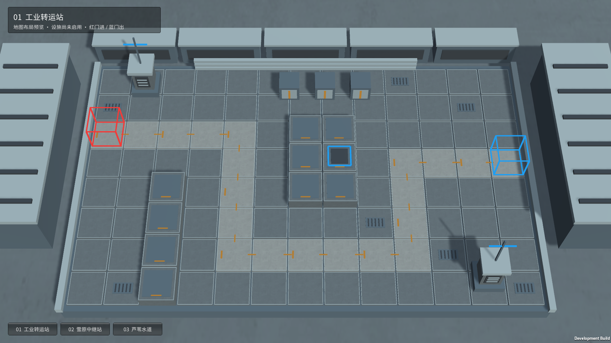
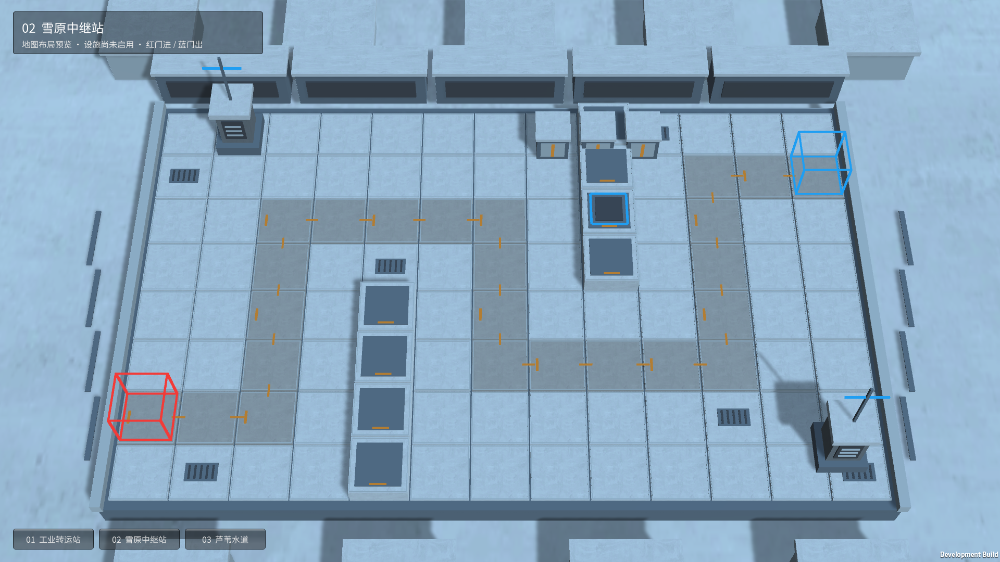
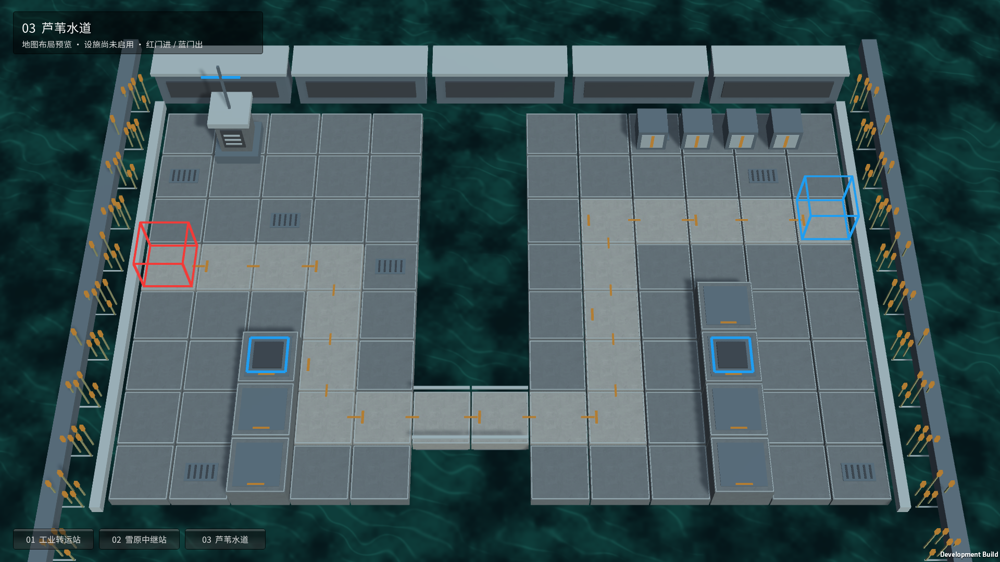

# 三张地图布局预览

2026-10-24，霍利屹 / Codex。关联任务 #22。用户调整优先级：先做地图，角色效果暂停。

本轮是独立 Unity 场景的第一版布局与环境预览，等待人工确认；尚未作为战斗关卡接入。

| 地图 | 路线与地形 | 预留设施 |
| --- | --- | --- |
| 工业转运站 | 从左上入口下绕，再向右侧出口折返；中央连续高台、两侧设备与仓储 | 祭坛插槽 |
| 雪原中继站 | 从左下沿两次折返进入右上出口；左右两排高台，雪地与通信设备 | 霜冻区域插槽 |
| 芦苇水道 | 两岸被水道分开，南侧唯一桥梁连接；过桥后折向右上出口 | 留声机、芦苇点火插槽 |

红色线框为入口，蓝色线框立方体为出口；蓝色地面方框仅表示未启用的设施插槽。浅色地面与琥珀色短线标出预定路线，带高度的深色格为高台。路线均为固定轴向折线；这些场景没有新增寻路或战斗规则。

## 查看和重建

使用 Unity **6000.6.5f1** 打开工程，直接打开 `Assets/_Game/MapPreviews/` 下任一 `.unity` 场景查看。菜单 `Yesterday Convoy / Map Previews / Generate Three Scenes and Images` 可重建三张独立场景，并在 `artifacts/map-previews/` 生成 1920×1080 实际渲染图片。不要把预览场景当作已有角色战斗入口。

Windows 查看器入口：本地构建后的 `Builds/MapPreviews/MapPreviews.exe`。底部按钮切换三张地图，查看器只有地图展示功能。构建方法 `YesterdayConvoy.Editor.MapPreviewTools.Build` 直接指定三张场景，不改项目全局 Build Settings。

关键连接：`MapPreviewTools` 制作独立几何、材质、相机、灯光并保存场景；`MapPreviewNavigation` 只负责中文标题和场景切换。没有改动 `InitialDemo.unity`、现有角色效果、共享 Prefab、包或项目设置。

## 来源与许可

- 路线设计、几何、箱体、通信设备、桥梁、芦苇、设施插槽和专属材质参数均为本项目程序制作；没有提取原游戏地图、标志或截图。
- 地面复用工程已有 `concrete-color.jpg`：ambientCG **Concrete034**，CC0。原始页面 <https://ambientcg.com/view?id=Concrete034>，许可 <https://docs.ambientcg.com/license/>，现有登记见 `docs/art/CREDITS.md`。没有改动源贴图或它的导入设置。
- 水面复用本项目已有 `YesterdayConvoy/Static Canal` Shader。中文字体复用工程已有 Noto Sans SC，沿用仓库字体许可记录。
- 新增材质、场景及所有必要 `.meta` 随源码保存；查看器不引用未入库的原作角色素材。

## 当前限制

这是布局样板，装饰细节仍较简化，尚待用户审美确认。设施目前是位置标记；祭坛、封地、留声机、燃烧芦苇均未在这些预览中实现效果。尚无敌人、防守阵容、部署、胜负或关卡选择接入，不能以预览程序启动代替战斗验收。确认地图后再继续设施与角色效果。

## 实际验证（2026-10-24）

- Unity 6000.6.5f1 编译、生成三张场景，连续路线格存在、无碰撞组件、材质非空检查通过；1920×1080 编辑器相机实际渲染并人工检查。
- Windows Development Build 成功，构建报告 246,275,899 字节。独立 Player 分别加载地图 0 / 1 / 2，均正常退出 0；实际窗口截图已逐张检查，中文标题、切换按钮、格子、门与水面可见，本文附图来自 Player。
- 自动截图需要显示窗口。隐藏窗口的早期截图尝试失败，最终使用可见窗口、帧末读取像素并由 .NET 写文件通过，不把失败尝试记为成功。
- 日志含显卡 D3D12 调试信息队列查询提示，最终画面正常；没有角色战斗测试。未做第二台电脑验收、按钮鼠标点击自动化或设施效果验收。
- 复现命令：构建后以 `--preview-map=0`（可选 0/1/2）指定地图；附加 `--preview-capture=<绝对目录>` 可在显示窗口后保存截图并自动退出。
