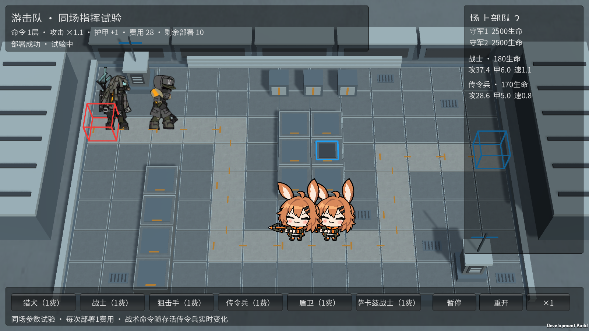
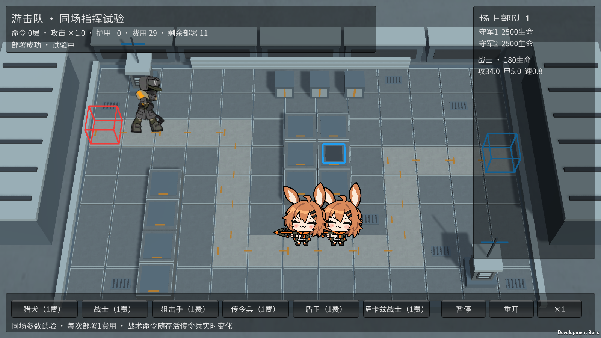

# M15 游击队战士：收到命令时加速

霍利屹 / Codex，2026-10-25，任务 #36 / PR #27。

打开 Builds/GuerrillaTrials/YesterdayConvoy-Guerrillas.exe，先部署战士，再部署传令兵。战士的实际移动从0.8变为1.1，侧栏显示速度；原步行动作继续按真实路程推进。多个传令兵仍叠加攻防，但额外移速只加一次0.3；全部传令兵离场后恢复基础速度。暂停/重开正常。完整原M15入口没有指挥者，仍保持基础0.8。

OrderRunner默认关闭，只在M15配置开启；UnitMoveMultiplier复用已有实际移动和废墟预测入口，不另推视觉根节点，不改变路线、原图、GUID或动作造型。命令是否存在读取真实存活指挥者；不把一个永久面板加成或额外技能按钮当作收到命令。此前M17的选择页说明也补为战术命令，独立关侧栏新增各自速度。

核对原始enemy_1078_sotisc的strength.move_speed=0.3及基础moveSpeed0.8，参考原始enemy_database.json和[游击队战士资料](https://prts.wiki/w/游击队战士)。这是固定+0.3，不误写成+30%。既有素材来源/权利沿用docs/art/M11-M20-INTEGRATION.md及source-records，不新增原图或变更许可。

Unity6000.6.5f1：177/177 Edit、52/52完整GPU Play通过，零失败零跳过。覆盖实际移动、来源死亡后恢复、多来源只生效一次、默认关闭、暂停/重开；实际同场原战士/传令兵场景测得半秒基础距离0.4、命令后0.55。最终Windows独立游击队729,860,909字节、设施732,330,543字节、完整846,381,722字节，0错误。

Windows独立Runner Player退出0，合法部署后实际距离0.400000006和0.550000014、命令/距离/暂停/重开通过，无注入状态。原完整M15 Player正常部署、普通攻击、受击、三只突破、胜负和清理亦通过。Player只测命令前后提速，指挥死亡后的恢复与多源去重由模型测试覆盖，不虚报该Player已经见到死亡恢复。证据artifacts/m15-*，下面是实际最终截图。

源码、必要meta及两张图随codex/monster-deep-pool-effects、PR27交付。接收者使用Unity6000.6.5f1和GuerrillaTrialTools.Build重建，或BaselineTools.BuildWindows / FacilityTrialTools.Build，保留完整输出目录；源码见各Builds/SOURCE.txt。受限同场试验部署仍为共享1费/次数/冷却，不等于正式商店/构筑。未第二机、人工完整通关或长时性能；M16/M18/M20继续。未改主场景/Prefab/包设置，无ZIP/Release或自动合并。

