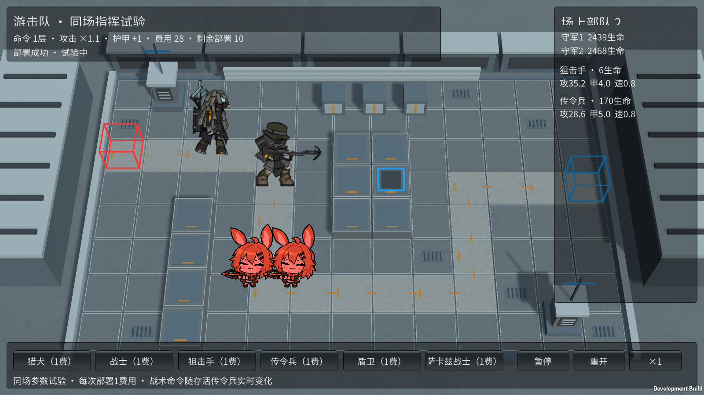
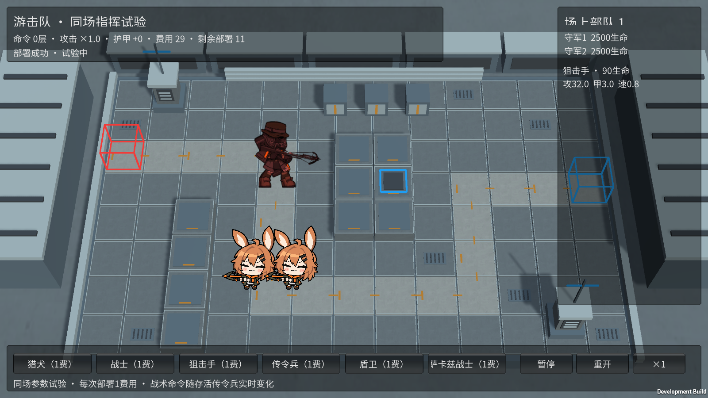

# M16 游击队狙击手：命令双目标

霍利屹 / Codex，2026-10-25，任务 #37 / PR #27。

运行 Builds/GuerrillaTrials/YesterdayConvoy-Guerrillas.exe，先部署狙击手，等其开始单目标攻击，再部署传令兵。有真实战术命令时，一次普通攻击对最多两名不同、存活、可选且在射程内的守军发射真实弹道；每轮仍只计一次攻击，原射击动作不重复播放两遍。多名传令兵不增加第三个目标，来源全部离场后恢复单目标。完整原M16入口无传令兵，保持普通单目标。

OrderSniper默认关闭，仅M16开启；实际发射数量读取UnitAttackTargets，沿用原普通弹道、伤害前摇、命中和死亡取消。额外普通目标也排除迷彩，避免第二发越过可选性规则；仅一名目标时不会重复射同一人凑两发。原卡面/行走/射击/死亡、图集和GUID未改，程序弹道不是新制作的原版双箭特效。

独立试验两名守军移到(-2.5,-2)、(-1.5,-2)，让固定路线上的狙击手确实能同时覆盖两人；只改此试验的布置，守军生命/攻防和原M16配置数值保留。守军显示缩为0.85以方便看清相邻目标，不改变逻辑位置、射程、碰撞或伤害。此图仍是6只基础角色的受限同场入口，共享1费/冷却/次数，不是正式阵容系统。

来源enemy_1079_sotisp，[原角色说明](https://prts.wiki/w/游击队狙击手)与原始enemy_database.json确认受到战术命令时额外攻击一名目标；既有媒体许可记录沿用docs/art/M11-M20-INTEGRATION.md/source-records，未新增许可或改标CC0。

Unity6000.6.5f1：181/181 Edit、53/53完整GPU Play通过，零失败零跳过。覆盖无命令一目标、命令后两名真实命中、来源死亡恢复、仅一目标不重复、多名指挥仍最多两人、额外目标迷彩排除；实际原造型场景自然完成单目标到双目标。命中前后正常经过弹道，不直接改守军生命。

最终Windows独立游击队729,865,402字节、设施732,335,036字节、完整846,386,230字节，0错误。Sniper Player退出0，normalSingle/commandedTargets=2/distinct/bothApplied/oneAttack/pause全通过，重开清空；原完整M16 Player部署、普通攻击、受击、三只突破、胜负清理通过。死亡恢复、目标上限/迷彩边界由模型覆盖，不冒充该Player逐项都展示。日志artifacts/m16-*，以下为真实两名目标命中前后。

源码、必要meta/图随codex/monster-deep-pool-effects、PR27提交；接收者用精确Unity6000.6.5f1与GuerrillaTrialTools.Build、FacilityTrialTools.Build、BaselineTools.BuildWindows重建相应入口，保留整个输出目录，来源见各Builds/SOURCE.txt。主场景/共享Prefab/Packages/ProjectSettings未改，无ZIP/Release或自动合并；未第二机/人工完整通关/长时性能。M18盾卫和M20爱国者继续。

