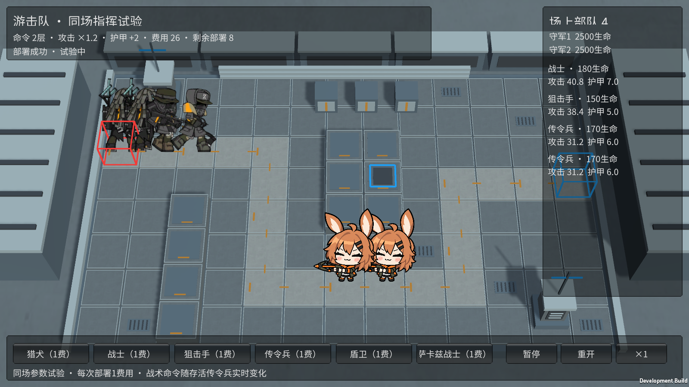
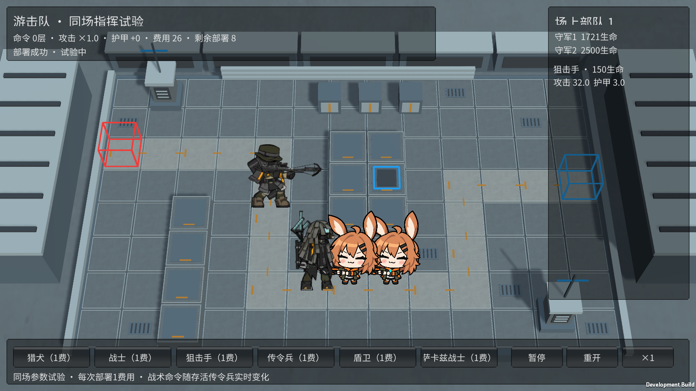

# M17 传令兵：同场战术命令

霍利屹 / Codex，2026-10-25，任务 #35 / PR #27。

## 试玩

打开完整目录中的 Builds/GuerrillaTrials/YesterdayConvoy-Guerrillas.exe。依次部署战士、狙击手、两名传令兵，左上“命令2层”显示攻击×1.2、护甲+2；侧栏可查看每人的实际生命、攻击、护甲。传令兵被守军正常击倒后支援减少，全部离场后恢复原值。空格暂停，界面可重开/加速。

这次是真实不同角色同场：M03、M15–M19使用各自已确认Card/Unit/Engagement和原图集，部署时读取自己的生命、速度、攻击、护甲、法抗、射程/间隔及动作参数；没有给同一卡改UnitId冒充混编。已有完整入口M17也启用自动战术命令。

## 当前机制和边界

每名存活、在场的传令兵给全场进攻方攻击+10%、本作护甲+1，包含传令兵自身，多个传令兵可叠加。护甲+1是将原+100按本作显示尺度适配，不直接把100塞进当前伤害尺度。两名时×1.2/+2，死亡或突破离场立即不再计数，不留永久加成；暂停冻结实际战斗，重开清空实体/弹道/命令层数。

参考原始enemy_1080_sotidp的strength.atk=0.1、strength.def=100；[传令兵资料](https://prts.wiki/w/游击队传令兵)说明全场命令，[原教学TR-17](https://prts.wiki/w/TR-17_重点打击)明确多个指挥叠加。原数据副本仅作本机参考，不是新增素材许可。

BasicRosterProfile是受限、不可变的角色快照，只接受这6只已登记的基础角色；复杂首领/主动技能组合会明确拒绝。TryDeployRole复用原费用、冷却、入口占位、暂停、请求去重和回合限制，不绕过合法部署；重复请求换卡会被拒绝。每个实体的基础战斗参数由UnitCombat读取，守军参数和阻挡容量仍属于关卡，不从某只角色的配置泄漏。没有配置多角色的旧单卡入口继续走原默认数据，173模型/51场景回归已验证。

独立试验采用30费用、12次总部署、每次1费/共享0.5秒冷却，两名守军各2500生命/18攻击/护甲3/4射程/阻挡1；单位沿用各自既有试玩参数。这是同场机制试验，不是正式商店、招募费用、各卡备战/部署次数或完整阵容系统。M15命令移速、M16命令双目标、M18嘲讽和爱国者阶段仍分步接入，不能把本轮基础同场和传令兵加成当成它们已完成。M19在此图无祭坛时保持普通状态，其祭坛效果在独立设施关另有完成记录。

## 验证与交接

Unity6000.6.5f1：173/173 Edit、51/51完整GPU Play通过，零失败零跳过。模型覆盖真实各角色参数、叠加和即时死亡/突破失效、护甲与伤害、陌生角色/重复请求/冷却/入口/暂停、重开保留登记和配置时机。实际GPU场景展示3种原造型和两名传令兵支援，守军正常攻击造成死亡后支援归零，未注入生命或伤害。最后只修正独立试验界面重叠/文字截断，重新构建后实机复核。

最终Windows独立游击队729,858,246字节、设施732,327,882字节、完整入口846,379,057字节，均0错误。最终独立Player退出0：合法部署、3种真实角色、两层叠加、守军命中致死、支援消退、攻击回1/护甲回0、暂停/重开全True。原完整M17入口的部署/暂停/普攻/受击/单只结算/三只部署/突破获胜/返回清理亦实机通过。日志本机artifacts/m17-*；下面是修正文字布局后的实际画面。

新增独立GuerrillaTrials/GuerrillaCommand场景/必要meta，源地图引用复用原工业预览材质，不改主场景、共享Prefab、Packages/ProjectSettings。M17媒体16项已经跟踪，全部6只角色的运行媒体沿用已有仓库，无新增原PNG、GUID或权利状态修改。新脚本/meta、场景/meta、图和本文随源码提交；原素材权利记录保持真实，不改标原创/CC0。

接收者拉取codex/monster-deep-pool-effects（PR27），用精确Unity6000.6.5f1，GuerrillaTrialTools.Build生成独立试玩；FacilityTrialTools.Build和BaselineTools.BuildWindows生成已有入口。GuerrillaTrialTools.Generate只在需要重建此独立场景时使用。保留整个构建目录，源码见各Builds/SOURCE.txt；没有自动ZIP/Release或合并。第二台电脑、完整人工通关与长时性能未验证。

