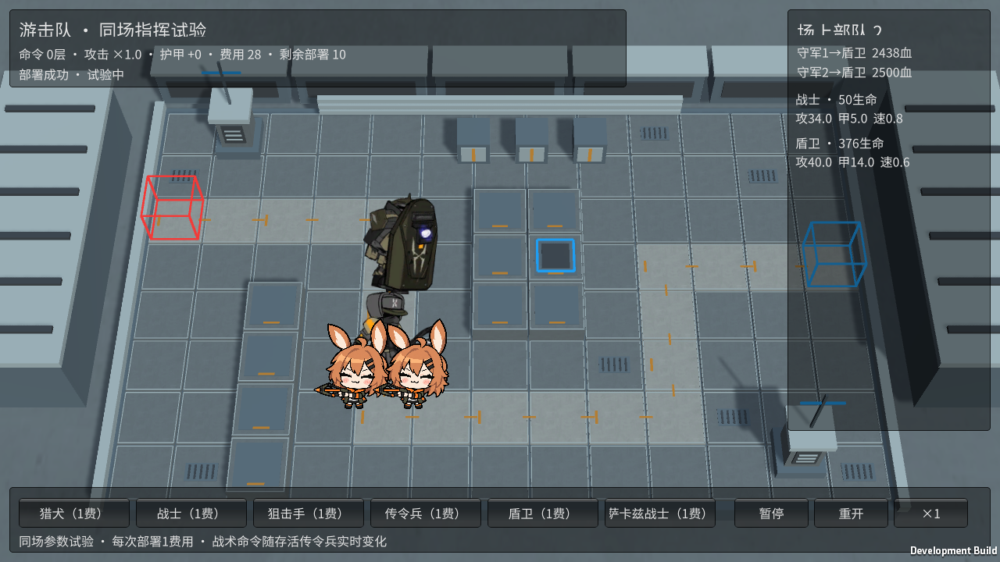
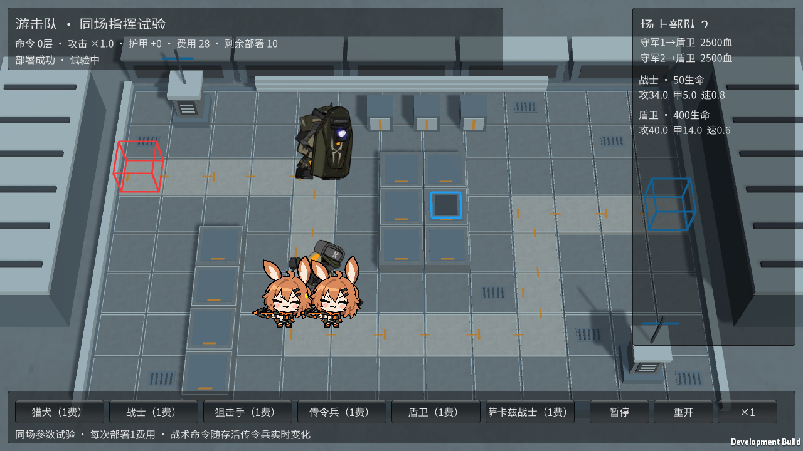

# M18 游击队盾卫：吸引火力掩护队友

霍利屹 / Codex，2026-10-25，任务 #38 / PR #27。

运行 Builds/GuerrillaTrials/YesterdayConvoy-Guerrillas.exe，先部署战士，约3秒后部署盾卫。守军原本攻击战士，盾卫进入射程后转向盾卫。侧栏直接显示守军当前目标和双方生命。已经发射的旧弹道保留原目标；随后实际射击由盾卫承受，不给队友增加无敌或减伤。

TauntLevel默认0，仅M18配置1；有更高优先级目标进入实际射程时重新选择。沿用可选性、存活、隐匿、对空和阻挡限制。正在阻挡敌人的守军优先攻击自己阻挡的对象，范围外盾卫不能吸引攻击；同级有效旧目标保持原规则，盾卫死亡后恢复选择其他合法目标。此规则没有额外时长或冷却，也不依赖传令兵存活。

原始enemy_database.json内enemy_1081_sotisd的talentBlackboard为taunt.taunt_level=1，核对后接入该项。原配置的试验生命、护甲、移动速度等保持不变，未冒称完全复刻原作数值。复用已跟踪卡面和基础原动作、图集/meta/GUID，没有新增或重绘原素材，既有来源/权利说明沿用docs/art/M11-M20-INTEGRATION.md及source-records，不新增授权主张。Move_Begin/End等未用动作没有标为完成。

独立关仍是6只基础角色的受限同场试验，每次共享1费/次数/冷却，不是正式商店、全池混编或正式阵容。主InitialDemo、共享Prefab、Packages/ProjectSettings不改。来源文件、脚本、必要meta和实际截图随功能分支提交；Builds、artifacts缓存不提交，不制作ZIP/Release，不自动合并。接收者需精确Unity6000.6.5f1，运行GuerrillaTrialTools.Build、FacilityTrialTools.Build或BaselineTools.BuildWindows，保留完整输出目录。第二台电脑、人工完整键鼠通关和长时性能未验证。

186/186 Edit通过，覆盖入射程转火、死亡恢复、范围外无效、阻挡优先和默认兼容/非法配置。首次完整GPU Play为53通过/1失败；实际Player已转火且战士保持50生命、盾卫400降至376，但测试错误检查了守军弹道未记录的DamageDealt字段。修正验证为真实Applied命中与生命减少，不更改伤害规则；后续复跑结果待记录。

修正后定向GPU场景1/1、完整54/54 GPU Play通过，零失败零跳过。最终Windows游击队729,869,877字节、设施732,339,514字节、完整846,390,706字节，0构建错误。Taunt Player退出0：原目标为战士、两名守军转盾卫、战士生命不变、盾卫实际命中扣血、暂停重开均True，无注入伤害。模型死亡恢复和阻挡边界不冒称该Player逐项演示。

原完整M18 Player退出0，部署/暂停/普通攻击/受击/单只结算/三只突破/胜负/返回清理均True。M18原媒体25项已跟踪且本轮文件未被忽略，无需扩大.gitignore。日志artifacts/m18-*，当前构建对应提交见各Builds/SOURCE.txt。
