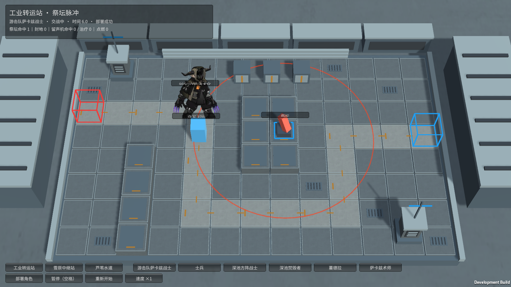
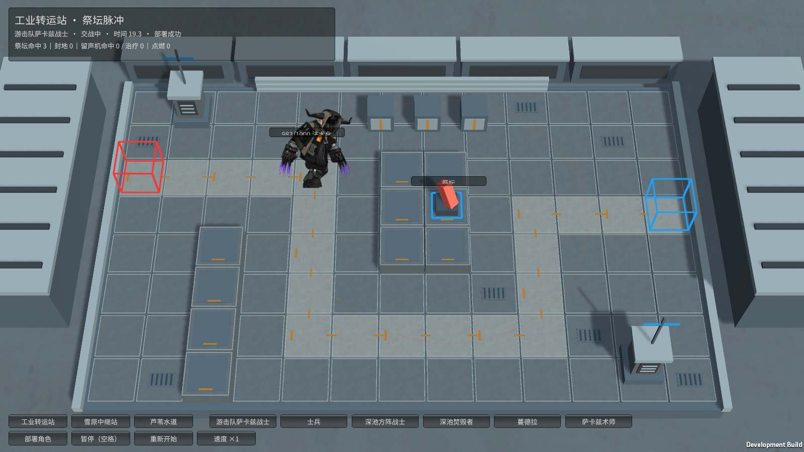

# M19 祭坛强化后的造型与动作

霍利屹 / Codex，2026-10-25，任务 #34 / PR #27。

M19游击队萨卡兹战士的真实祭坛免伤、永久法术化已在此前设施任务接入。本轮补齐触发后的原强化造型：extra_idle_2、extra_move_2、extra_attack_2、extra_die_2，分别对应待机、行走、攻击和死亡。只有实际AltarEmpowered事件成立才换造型；没有祭坛的完整入口仍用普通四段，不制造自动变身。

强化普攻沿用当前0.6秒伤害前摇，完整原动作1.6333秒播放完才允许继续移动；正常M19仍按原1.1667秒动作收势，其他角色时长不变。祭坛接触时如正在攻击，造型按该次攻击的真实进度切换，不新增不存在的变身动作。本轮只接额外动作，未改角色生命、攻击、护甲、移动或原PNG/GUID。

试玩：Builds/FacilityTrials/YesterdayConvoy-Facilities.exe → 工业转运站 → 游击队萨卡兹战士 → 部署。6秒祭坛脉冲自然激活，紫爪强化造型开始法术近战。该角色独立试验将守军生命15000调为400，使击杀守军后还能自然看到强化行走；模型生命1000/其他战斗参数保留。完整入口Builds/Windows/YesterdayConvoy.exe选M19可比较普通造型。

GPU定向新场景1/1通过，随后完整50/50 Play通过、零失败零跳过。场景自然激活并展示强化待机/行走/攻击；强化死亡另在合法战斗配置中由真实守军命中造成，祭坛先触发并确认不扣生命，实际死亡后读取extra_die_2连续帧，未直接改生命或状态。此前165 Edit结果属于上一批，本轮没有新增Edit测试，不将静态检查当编译。

Windows设施732,312,502字节、完整入口846,363,661字节，0错误。实际设施Player退出0，normal/empowered/walk/idle/attack、暂停/重开全部True；实际无祭坛完整M19 Player退出0，部署/暂停/普攻/受击/单只结算/三只突破/胜负/清理全True。强化死亡由GPU实际受击配置验证，本轮设施Player未自然死亡，不标为Player已覆盖。日志artifacts/m19-*，实机图如下。

原型enemy_1084_sotidm，参考原始enemy_database.json的祭坛免伤/法术化与docs/art/M11-M20-INTEGRATION.md、原source-records。45项既有媒体/清单/meta已跟踪且未被忽略，新增程序/测试meta和实机图随源码；来源和权利状态保持真实，无新增许可或CC0声明。独立设施无需换场景/Prefab引用；未改主场景/共享Prefab/Packages/ProjectSettings。接收者使用Unity6000.6.5f1及FacilityTrialTools.Build / BaselineTools.BuildWindows构建，保留全部输出；源码见各Builds/SOURCE.txt。第二台电脑、完整人工通关、长时性能未验证；传令兵/盾卫混编与爱国者阶段继续。

