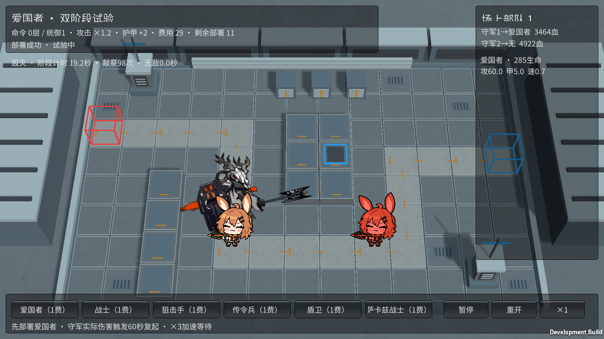
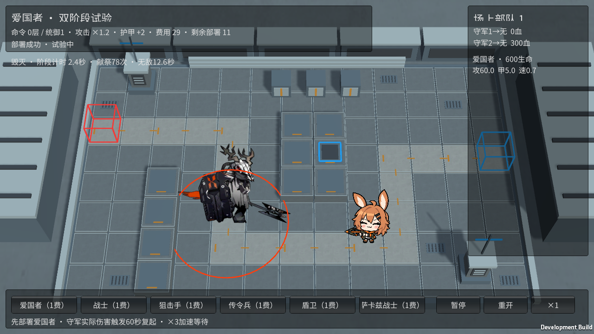
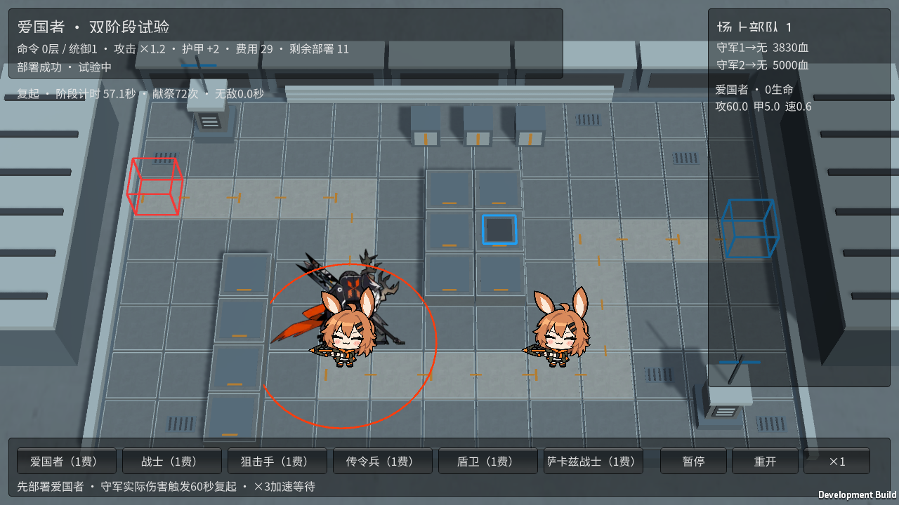

# M20 爱国者：双阶段试验

霍利屹 / Codex，2026-10-25，任务 #39 / PR #27。

独立入口 Builds/PatriotTrial/YesterdayConvoy-Patriot.exe。先部署爱国者，守军会用真实攻击使其首次生命归零；进入60秒复起，恢复满生命后进入毁灭，拥有15秒保护。可用×3缩短现实等待，不压缩战斗时钟中的规则。每次部署仍是独立试验统一1费，不是正式卡价。

机制由PatriotEffects与原交战模型执行：统御给全场攻击+20%、本作护甲+2并提供战术命令，多名爱国者只保留一份，复起期间继续支援他人；从复起开始自身不再吃自己的统御，其他传令兵支援仍保留。行军自身攻击×1.5、护甲×3、法抗×2、高仇恨2，只在被阻挡时进行四次实际物理命中。四次使用原攻击动作，额外命中间隔0.2秒是本作对原动作的试验映射，不宣称原版逐帧事件时间完全一致。

毁灭移速固定+0.1、普攻间隔-0.4，攻击范围0.85，使用原第二阶段攻击。复起和毁灭每0.8秒对半径1.75内的守军造成基础攻击5.21%的实际真实伤害，绕过护甲/法抗与迷彩，程序圆环只做反馈。投枪初始15秒，锁定20格内明确标记为高台的最远可选守军，3秒蓄力后真实弹道造成135%物理伤害；保持原3.4333秒完整动作，结束后20秒冷却。高台只由开战前配置，不从画面高度猜测，且不能阻挡。没有高台就等待，不造目标；来源死亡会取消待命中弹道。

原始enemy_database.json的enemy_1506_patrt提供阶段/光环/献祭/投枪数值；阻挡四连击、最远高台和蓄力行为核对[PRTS角色条目](https://prts.wiki/w/爱国者)。本作原配置改为试验基础攻击60/护甲5/间隔4/法抗45，生命600、移动0.6沿用既有样板；不是原作45000生命等平衡复刻。独立关守军生命5000、攻击110、射程1.1、间隔1.6，保证正常攻击后仍能观察完整复起和投枪。原完整入口守军放在原路线上并允许阻挡，使行军近战能实际发生。

复起使用现有三段原动画，毁灭使用第二阶段待机/行走/攻击和投枪原动作；11段原动作及PNG/清单/meta均已有跟踪，现已加入实际加载白名单，保留GUID。首次定向场景发现白名单遗漏，补齐后通过。死亡仍使用既有死亡动作，没有新绘死亡或原版特效/声音。原素材来源和真实权利记录沿用docs/art/M11-M20-INTEGRATION.md/source-records，无新增授权声明。

毁灭拒绝本轮定向控制接口的眩晕/冻结，复起及15秒保护拒绝受伤；原支柱眩晕也不会阻止毁灭行动。尚无通用全角色控制/浮空系统，不把一个角色的免疫写成已完成所有状态系统。祭坛沿用既有M20免疫。守军无飞行状态，本轮没有伪造对空验收。

Unity6000.6.5f1最终198/198 Edit、56/56完整GPU Play通过，零失败零跳过；前置三项定向场景通过。覆盖60秒边界、15秒保护、二次死亡不再复起、护甲/法抗/仇恨阶段差异、四次独立实际命中、真实伤害穿甲与迷彩、投枪选择和周期、来源死亡取消、高台不阻挡、光环不叠加及复起继续支援、M15/M16接收命令、控制/暂停重开。原主入口全角色回归已通过。

曾发现两处连接问题：M20额外动作尚未加载、原守军离实际路线一格；分别加入现有7段额外动作白名单、将M20自己的守军位置设为(-1,0)且允许阻挡，不改主场景。新增联动测试曾过早检查尚未走完前摇的弹道，等待实际命中后通过。

机动预设使用同一角色的真实规则，只将独立守军改为300生命/200攻击/4射程。可加--patriot-mobility启动，前期火力提前触发复起，毁灭击杀近卫后可查看原第二阶段行走，GPU已实际验证；没有直接修改角色生命或阶段。默认持久预设用于观察行军四连击、复起与投枪。两组关卡参数不是原版关卡。

Windows实机和最终构建结果待完成后记录。主InitialDemo、共享Prefab、Packages/ProjectSettings未改，独立新Patriot场景；不自动合并、ZIP或Release。接收者用Unity6000.6.5f1及PatriotTrialTools.Build重新生成整个Windows目录。第二台电脑、完整人工键鼠通关及长期性能未验证。

机动Player首次检查抓到了“移动进入攻击范围、同一帧开始攻击”的过渡帧，实际移动成立但行走图断言失败；诊断改为同时等真实位移和原extra_move_2画面出现才截图，不修改玩法、伤害或阶段。最终实机结果后录。

最终四套Windows构建均0错误：爱国者729,889,405字节、游击队729,889,410字节、设施732,359,038字节、完整846,410,245字节。最终两个独立Player退出0：持久预设四次实际命中、真实受击/三段复起/60秒边界、实际高台投枪命中、98次献祭累计306.3457真实扣血、暂停重开均通过；机动预设自然复起后的实际位移与原extra_move_2行走画面均通过。最后仅修正诊断截图时机，玩法不变；最终定向GPU两项通过，先前完整198 Edit/56 GPU Play记录仍有效。原M20完整Player复核结果另列。

205项M20媒体及meta已跟踪，本轮独立场景、脚本/meta、实机图和说明同源码交付，检查忽略后没有漏项，无需扩大.gitignore。构建缓存和日志artifacts/m20-*不提交，源码版本见各Builds/SOURCE.txt。普通M20入口展示行军战斗，完整阶段使用上述独立关；不冒称主样板弱守军也能自然打出复起。

最终原完整M20 Player退出0，entered/paused/attacked/hit/resolved/three/won/noSkill/clean/frozen均True。三条最终Player都完成；未将历史构建或失败截图检查记成通过。
