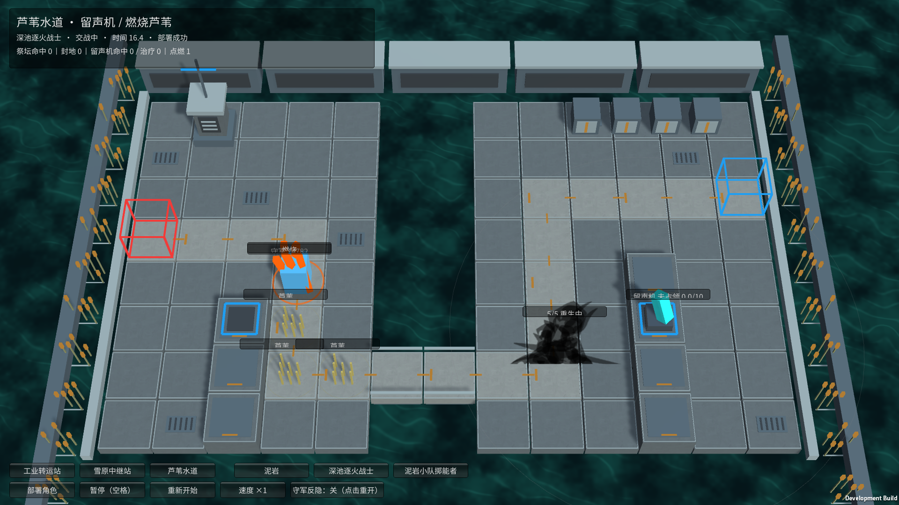
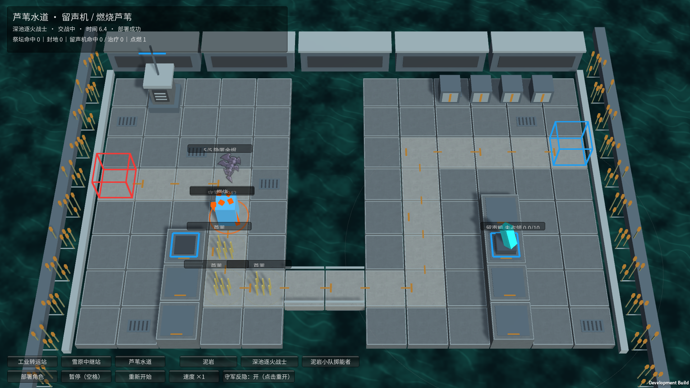
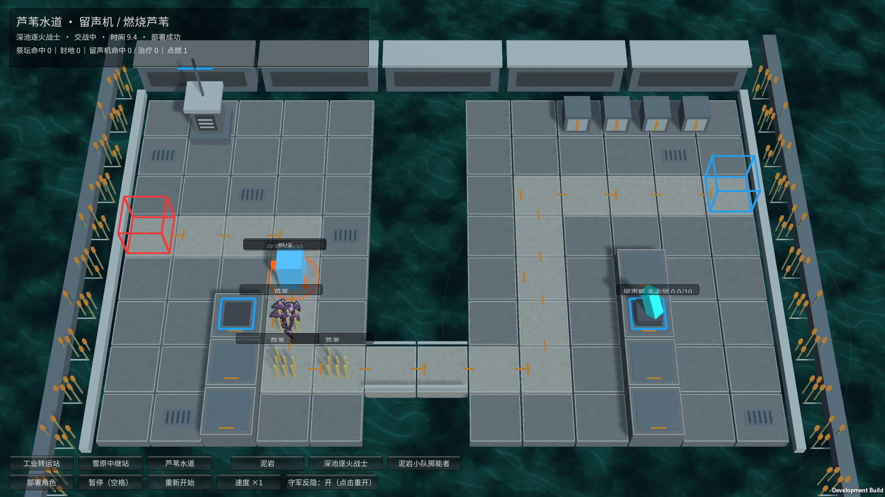

# M30 深池逐火战士：余烬与重生

霍利屹 / Codex，2026-10-25。任务 #26，分支 `codex/monster-deep-pool-effects`。依赖已提交的角色能力、M29方阵效果与三地图设施；不自动合并 main。

## 玩家能看到什么

在设施试玩选择“芦苇水道 → 深池逐火战士”，点击部署。地图第一丛芦苇预先起火，角色靠近燃烧芦苇时，正常命中的普攻附加灼燃。受到致命伤后，依次播放原倒下动作、余烬移动/待机、原重生动作；余烬被消灭则播放其单独死亡动作。

底部“守军反隐”切换会重开本场：关闭时可观察余烬躲避直接索敌后重生；打开时守军能继续攻击余烬，以观察5次受击清除。普通单怪测试入口也启用相同角色逻辑，但原场景没有配置燃烧芦苇，所以不会凭空获得环境灼燃。

## 当前机制

- 正常形态受到致命伤，转为1秒转化保护；解除阻挡并取消与这一生命有关的在途弹道，期间不移动、不受伤、不被选为攻击目标。
- 随后是5点特殊生命的余烬。每个成功伤害事件只扣1点，无论伤害大小或物理/法术/真实类型；没有让高伤害一次打掉5次生命。余烬继续沿既定路线移动、不攻击；被阻挡时停步并显形，脱离阻挡3秒后恢复隐匿。反隐守军可直接选择它，区域伤害仍能命中。
- 余烬存活10秒后开始1秒原版重生动作，动作期间保护；结束后恢复本作基础最大生命和满生命，可重复再次化为余烬。余烬真正被清除后不会复活。各部署实体独立。
- 正常形态保留50法抗。1.5格内有燃烧芦苇时，普通攻击在发射时记录附加自身攻击力100%的灼燃，实际命中才积累；没有火焰不附加，也不会把普通伤害改成火焰特效代替实际积累。
- 灼燃沿用设施试验的缩放规则：累计100后造成120法术伤害、降低20法抗（最低0）持续10秒，冷却期间不再积累。上述100/120是本作试验值，非原作1000/1200的完整数值。
- 状态、动作和计时均读取 `ManualBattle.Clock`；暂停冻结，暂停时拒绝伤害变更，重开清空形态、计数、弹道与表现。余烬阶段不通过治疗恢复受击次数。

依据为[深池逐火战士资料](https://prts.wiki/w/深池逐火战士)及已有模型对应 `enemy_1288_duskls` 的本地数据记录；不混用逐火护卫的10次生命或减伤。

## 对上一批设施试验的纠正

此前误将“靠近就点燃芦苇”写为M30能力。本轮删除该逻辑：M30只在已有燃烧芦苇附近获得灼燃攻击，起火点由地图明确配置。芦苇的正常蔓延、灭火、防再燃、迷彩和伤害规则仍在。旧截图与记录属于旧验证，不替换成未经运行的新证据。

为自然展示两条结果，本独立设施试玩的M30生命450、守军攻击65/间隔0.7秒、无阻挡，可选反隐；守军生命15000。只在本场构造快照，未改动其他角色配置或把试玩守军说成原版克洛丝。

重开应恢复地图的预置起火点（燃烧计数为1），不是把地图改成完全无火。实体状态和临时触发仍清空。

## 源码与运行素材

- `FlamechaserEffects` 负责形态、隐匿/反隐、特殊受击与条件灼燃；`ManualBattle`、`EngagementCombat`接入正常伤害、行动与索敌。默认关闭的新字段不改变其他角色。
- `DemoSpriteVisual` 和 `LocalMonsterArt` 使用已跟踪M30标准图集与 `ExtraClips/extra_idle_2`、`extra_move_2`、`extra_die_2`、`extra_revive`，没有用缩放、闪烁或其他角色图片冒充这些动作；未使用的 `extra_start` 不宣称已接入。
- 没有新增/替换原作PNG；原图集与meta已在依赖分支中保存，GUID不变。原作角色权利仍属于原权利人，不改称CC0，也不声称获得新许可。缓存、测试日志、构建和本地AGENTS不提交，无ZIP/Release。
- 主场景、已有共享Prefab、Packages与ProjectSettings未改；设施场景的工业站角色列表增加M29，水道增加了M30反隐试验开关。

## 边界

目前反隐是独立试玩守军的明确测试条件，不是完整干员反隐技能系统。环境灼燃使用既有缩放规则；没有新做完整元素抗性/商店/羁绊/正式关卡。这一只完成不等于M31喷火、M32蔓德拉或其他待做角色完成。

## 实际验证与实机图

Unity6000.6.5f1：104/104 Edit、43/43完整GPU Play通过，零失败零跳过，包含两次形态循环、各伤害类型5次受击、转化保护、解除阻挡后3秒显形、隐匿/反隐、暂停、重开、条件灼燃和实际ExtraClips。测试没有用假图替换角色。

随后发现Player自动验收仍要求重开后的起火数为0，与新地图预置火点不符；修正为核对初始火点，并定向场景1/1通过。这次没有修改玩法。最终设施Player两种模式均退出0：hidden的emberPose/revivePose/revived为True，reveal的emberPose/eliminated为True；部署、效果、暂停、重开均True，不注入生命或形态。早期reset=False的运行记录不记为通过。

完整怪物入口M29/M30的正常部署、受击、攻击、三只突破、胜负、返回清理通过；独立设施Player用于证明余烬和环境效果，不能拿未配置芦苇的老场景声称展示了该环境联动。构建与日志在artifacts/flamechaser-*和deep-pool-player-*，不随源码上传；图片随本说明保存。

最终Windows构建：设施试玩732,231,046字节；完整怪物入口846,282,310字节，均成功、无构建错误。操作入口分别是 `Builds/FacilityTrials/YesterdayConvoy-Facilities.exe` 与 `Builds/Windows/YesterdayConvoy.exe`，程序需要同目录配套文件，不只复制EXE。

仓库静态检查2610个跟踪文件通过；已核对四个实际使用的ExtraClips图集、清单及meta均在Git中。新增脚本/meta与实机预览未被忽略，主场景/共享Prefab/Packages/ProjectSettings无本轮修改。构建、缓存、AGENTS与.vscode未提交。

未第二机、人类完整键鼠通关、长时间性能或所有角色完成验收。运行日志D3D12调试信息队列查询提示仍存在，实际画面正常，无脚本异常。

