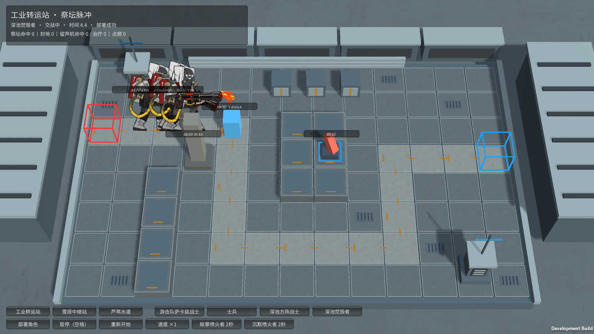
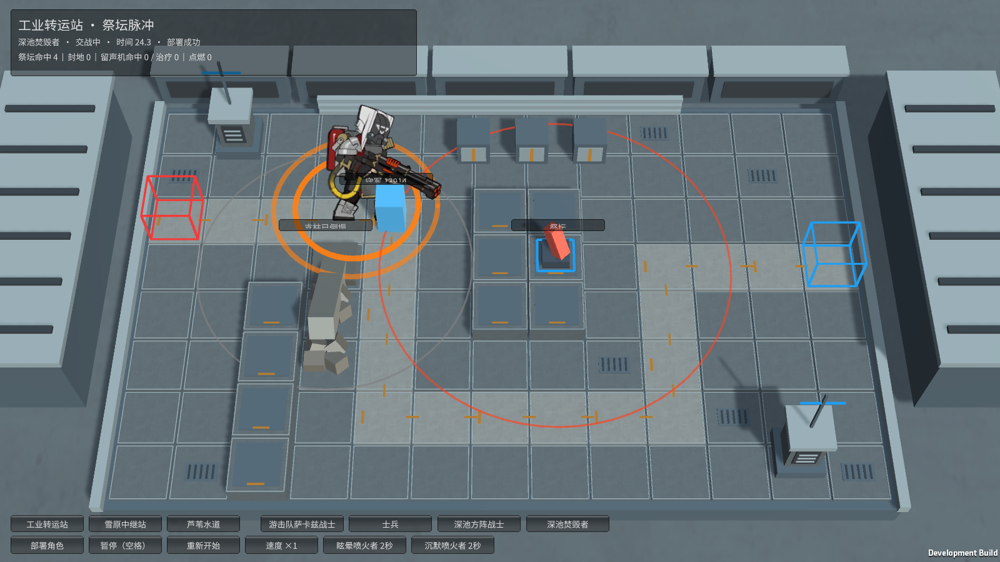
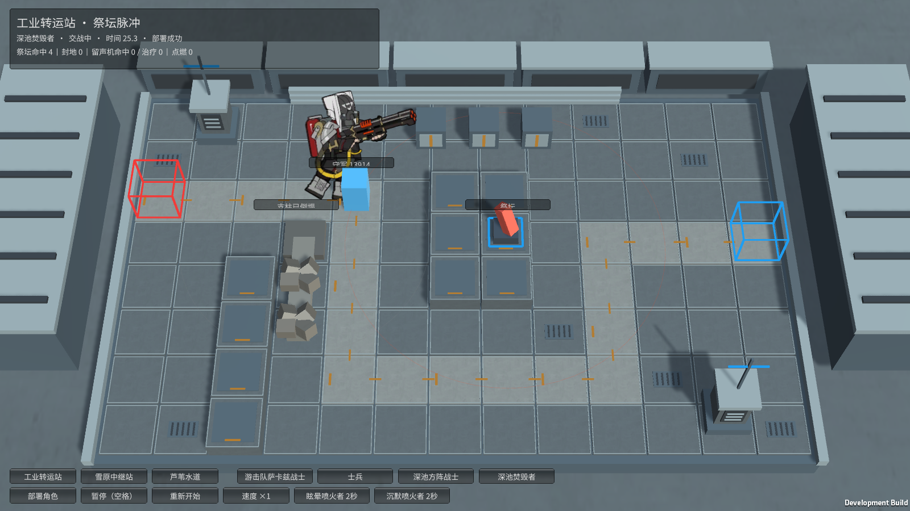

# M31 深池焚毁者：喷火、灼燃与燃料爆炸

本轮负责人：霍利屹 / Codex。任务[28](https://github.com/Peanora/YesterdayConvoy/issues/28)，交付到[PR 27](https://github.com/Peanora/YesterdayConvoy/pull/27)，功能分支 `codex/monster-deep-pool-effects`。这是已有模型的独立战斗样板，待干宸骅审查，不代表正式关卡或全部角色完成。

## 怎么试玩

运行 `Builds/FacilityTrials/YesterdayConvoy-Facilities.exe`，工业转运站下方选“深池焚毁者”，点击部署。一次部署可看完整喷火起手、持续和收招；连续部署三只可以看到灼燃爆发和死亡连锁。左侧灰色破碎支柱会被相邻爆炸推倒。提供眩晕、沉默各2秒的明确试验按钮；空格暂停，重新开始清空状态。角色和守军数值均为本作缩放试验值。

完整入口是 `Builds/Windows/YesterdayConvoy.exe`，怪物列表选择“深池焚毁者”，正常拖卡部署；守军保持无阻挡配置。支柱放在独立工业设施试玩，原主场景不增加设施。交接必须携带EXE同目录的Data、UnityPlayer等配套文件。

## 已接入的效果

- 普通攻击仅在被阻挡时释放，为物理伤害；主动喷火不要求被阻挡。无目标时继续按原路线移动。
- 喷火锁定一个地面目标并停止移动，持续10.6秒，每0.5秒造成12%攻击力的法术伤害、积累6%攻击力的灼燃，共21跳。目标死亡或离开射程停止，不会把后续伤害转给新目标。
- 灼燃复用本作已有缩放规则：累计100触发120法术伤害及10秒法抗降低20，爆发期间不重复积累。该数值不是原版元素数值，也没有额外赋予自动点燃芦苇能力。
- 眩晕和沉默均中断喷火，恢复时重新起手。前6秒持续清空冷却；本样板采用第6秒开始计10秒冷却，完整施法下一次最早在起手后16秒，提前打断仍要完成收招。这个冷却衔接是当前实现选择，保留后续核对空间。
- 致命伤害暂留1生命并停止攻击、取消未命中弹道、进入无敌且不可被守军选中的爆炸阶段。0.1秒后对射程内守军造成100%攻击力法术伤害，对附近同ID焚毁者造成100倍攻击力真实伤害，继而强制自身死亡；每个实体只进入一次死亡爆炸，连锁按队列结算。0.1秒是本作表现延时。
- 自爆会推倒相邻四格的破碎支柱；支柱背离爆炸来源倒下，覆盖两格，强制击倒其中守军，对进攻单位造成配置的真实伤害和3秒眩晕，可继续推倒其他支柱。仅声明为可部署地面的格子生成废墟；当前固定路线碰到废墟会停下，尚无动态绕路。试验支柱攻击1200、眩晕3秒是本作缩放值，未冒称原作12000攻击的平衡复刻。
- 暂停冻结伤害、冷却与动画时间；重开清空喷火、死亡队列、倒塌、废墟及角色状态，恢复地图初值。

## 动作、表现和素材

使用仓库已跟踪的M31标准卡面/待机/行走/普攻/死亡图集和9个ExtraClips（上、下、正面各起手、持续、收招）。持续段循环，起手0.5秒，收招约0.533秒；按目标所在方向选择，不以普通攻击帧冒充喷火动作。实机场景本轮自然覆盖正面三段，上下方向原帧已加载并接好选择逻辑，没有宣称完成所有朝向的人工视觉验收。

喷火流、爆炸波纹和支柱几何表现由本作代码绘制，不是原作完整VFX或音效复刻。没有新增或替换原PNG，保留既有图集GUID，新增脚本和测试的必要meta随代码提交。已核查.gitignore和实际跟踪：M31目录45项既有文件（含图集/清单/meta）均在Git中，本次运行依赖没有被忽略，不需要修改整个忽略规则。截图随文档提交；缓存、日志、构建、本地AGENTS与既存.vscode不提交。

原作角色及原图权利属于原权利人，现有来源/权利记录保持原状；学生作业用途不是新增的公开分发许可证据，本轮不将其改标为CC0或声称新获授权。

## 依据与范围

对照[深池焚毁者资料](https://prts.wiki/w/深池焚毁者)、[破碎支柱资料](https://prts.wiki/w/破碎支柱)和已下载的原作 `enemy_1173_duspfr` 数据：Flame持续10.6、半秒间隔、12%/6%比例、DeadBoom倍率1。原始数据路径来源为[ArknightsGameData enemy_database](https://github.com/Kengxxiao/ArknightsGameData/blob/master/zh_CN/gamedata/levels/enemydata/enemy_database.json)。不把6秒冷却控制点误当完整喷火时长。

当前仍是同一张卡多实体，未做焚毁者队长、混编编队、通用干员沉默/眩晕技能、完整元素抗性或完整支柱攻击/拆除系统；支柱目前由爆炸和倒塌触发。主场景、现有共享Prefab、Packages和ProjectSettings未改。M32蔓德拉及其他未完角色仍待继续。

## 实际验证

Unity 6000.6.5f1：最终114/114 Edit通过；完整44/44 GPU Play通过，零失败零跳过。恢复完整入口守军无阻挡后，全37只注册怪物部署/暂停/交战/胜利/重开的定向回归1/1再次通过。支柱移入场内并补上实际碎石表现后，M31定向GPU场景1/1再次通过。旧回归把“有攻击”仅认作普通弹道，初次漏计M31喷火而失败，已改为接受实际喷火伤害跳数；没有删除验收或伪造普通攻击。

独立设施Windows Player退出0，真实部署三只：start/loop/end/explosion全部True，chain=3、pillars=1、rubble=2、burn=1，未注入生命或效果，部署/暂停/重开均True。完整入口M31 Player退出0，entered/paused/attacked/hit/resolved/three/won/noSkill/clean全部True。构建成功不代替第二台机器验收；本轮尚未在第二机测试。

最终设施Windows构建732,251,349字节，完整入口846,302,622字节，均成功、0构建错误。

本机证据保存在 `artifacts/m31-*`，不上传日志和构建。图片是实际Player截屏：

