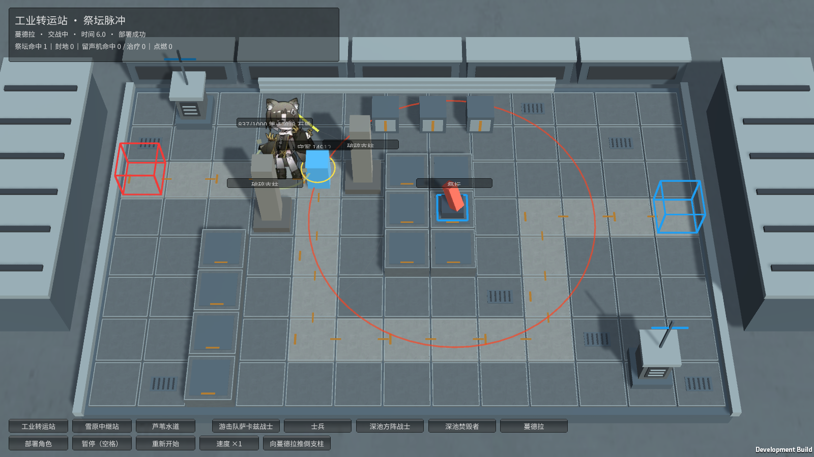
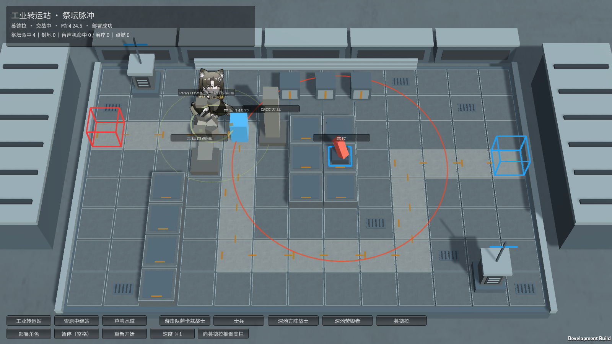
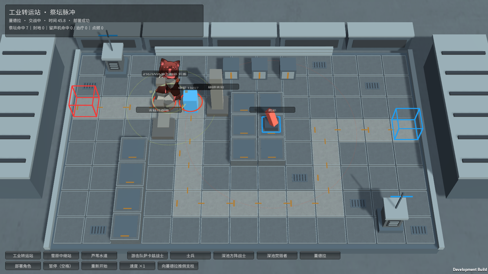

# M32 蔓德拉：石盾、重生、凝视与倒柱

霍利屹 / Codex，2026-10-25。[任务29](https://github.com/Peanora/YesterdayConvoy/issues/29)、[PR27](https://github.com/Peanora/YesterdayConvoy/pull/27)，继续 `codex/monster-deep-pool-effects`。这是已有原模型的独立角色效果样板，供干宸骅审查，不代表正式关卡和平衡已验收。

## 直接试玩

运行 `Builds/FacilityTrials/YesterdayConvoy-Facilities.exe`，工业转运站选“蔓德拉”，部署一只。她会停止移动释放凝视；点击“向蔓德拉推倒支柱”观察真实支柱伤害、破盾和技能中断。继续交战可看到首次重生、第二阶段悬浮、范围伤害及五秒红圈预警后的再次倒柱。暂停和重开按钮可用。

完整怪物入口为 `Builds/Windows/YesterdayConvoy.exe`，选蔓德拉并拖卡部署；该入口守军仍为可对空、无阻挡的既有测试守军，未往主场景添加支柱。两个EXE都需要同目录完整配套文件。

## 当前实现

- 出场石盾将护甲/法抗结算后的物理和法术伤害降低60%。真实伤害不享受该减免。
- 支柱砸中时解除石盾、中断凝视，随后结算柱子的真实伤害。破盾期间技能冷却冻结，25秒后或自破盾时起损失生命超过最大生命40%恢复。阈值为严格超过，不是等于。支柱采用本作3秒控制效果，不当作普通可沉默控制。
- 第一阶段只有被阻挡时进行法术普攻。首次致命伤进入5秒不可被选中的重生，期间不移动、不攻击、不受伤、不通过治疗跳过阶段。结束满生命切到第二阶段，获得3秒伤害保护、石盾和10秒首次凝视冷却。
- 第二阶段可远程法术普攻；有石盾时悬浮、无法被阻挡，只能被可对空守军选中。每秒对1.7范围内可选守军造成30%攻击力法术伤害。破盾立即落地；恢复盾会解除旧阻挡。
- 凝视起始冷却5秒，锁定1.5范围内目标，持续7.1秒、每秒100%攻击力法术伤害、攻速最终乘0.3；目标倒下时封印其地块并在原结束时间内续锁，不重新开始整段时长。当前所有守军共用同一攻击配置，等攻击力按生成顺序选取，未冒称存在不同攻击力干员阵容。冷却按当前样板在结束后计15秒。
- 第二阶段20秒后寻找最近的有效现存支柱，朝两格内守军最多方向发出5秒预警并倒塌，之后15秒再检查。未满足条件不凭空造柱；指令提交后即便施法者倒下，地形倒塌仍按预警结算。没有把旧攻略的“召唤”措辞误做无限新增柱子。
- 倒柱复用M31的两格真实伤害、守军强制击倒、同类柱连锁、有效地面废墟及固定路线阻挡。独立试验提供明确倒柱按钮，自动验收也走同一个地图交互，未修改生命或强制切换阶段。
- 暂停冻结形态、伤害、冷却、预警和动作；重开清除所有凝视/指令/封地/废墟与角色计数。

## 原动作与画面

原基础图集实际是C2无盾版本；本轮接入全部18个已有ExtraClips，使初始角色使用C1动作，二阶段带盾使用C2的_1版本，破盾使用原基础_2版本。凝视Begin/Loop/End、补盾、倒柱、破盾及Reborn选择均由实际状态驱动。原Reborn为7.333秒，本作按5秒玩法时间完整重采样播放，不额外拖长逻辑保护时间。

本轮自然实机覆盖第一阶段凝视、破盾、重生、二阶段带盾状态、范围伤害和倒柱动作；没有宣称18个片段均已逐帧人工验收。石盾环/漂石、射线、范围环和倒柱红圈由代码绘制，不是完整原作特效或声音复刻。

## 来源、配置与素材

以原 `enemy_1523_mandra` 基础级数据为准：60%减伤、破盾25秒/40%损失阈值、重生5秒、二阶段3秒保护、1.7范围/30%攻击力、凝视7.1秒等。升级数据的65%/35%不混入。参照[原始敌人数据](https://github.com/Kengxxiao/ArknightsGameData/blob/master/zh_CN/gamedata/levels/enemydata/enemy_database.json)及[蔓德拉资料](https://prts.wiki/w/蔓德拉)。本作技能冷却衔接、固定路线等适配如上明列，不冒称逐行复刻原AI。

独立设施试验角色生命1000、守军生命15000/攻击110，初始两根支柱伤害120和150；这是本作缩放试验参数。完整M32配置只校正攻击距离1.5、间隔1.8并设置35法抗，其他角色的开关默认关闭。

M32媒体目录83项图集/清单/meta原已跟踪，本轮没有新增或替换原PNG，GUID保留。检查全部忽略来源，运行依赖未被忽略，不需要取消.gitignore。新脚本和测试的必要meta、实机截图与代码一起提交。原作素材权利状态不变，不标CC0；学生作业用途不等于另有公开分发许可。日志、缓存、构建、本地AGENTS和既存.vscode不提交。

## 验证与实际边界

Unity6000.6.5f1：127/127 Edit通过，45/45完整GPU Play通过，零失败零跳过。最后补充倒柱在无敌期间不能破盾或遗留眩晕的回归，M31/M32两个定向GPU场景2/2通过。测试包含双类型减伤、真伤破盾、严格40%阈值、25秒恢复、冷却冻结、唯一重生、对空限制、凝视跳数/续锁/封地、暂停/重开及实际原图集场景。初次回归发现ExtraClips帧没有名称，已补齐真实角色/片段/帧号，再跑完整回归通过，未删除资源身份核验。

最终独立Windows构建732,273,402字节，完整入口846,324,654字节，0构建错误。设施Player退出0：gaze/manualPillar/broken/reborn/airborne/warning/collapsed全部True，范围伤害26次，无注入生命；部署、暂停、重开全部True。完整M32入口Player退出0，部署、暂停、实际攻击、受击、单只结算、三只突破、胜负和返回清理全部True。证据位于本机artifacts/m32-*。

仍未做：正式混编战斗、动态绕路、通用干员控制/不同攻击力阵容、原作全部声音和粒子特效、第二台电脑验收。保留上述实现衔接选择供审查。M33等其他角色继续，不因这一只完成而标全部完成。

