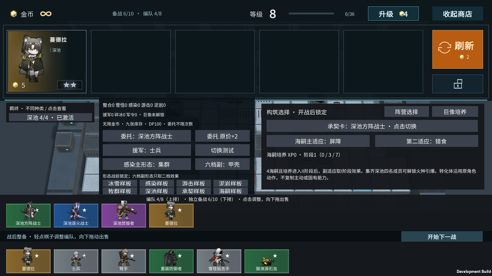
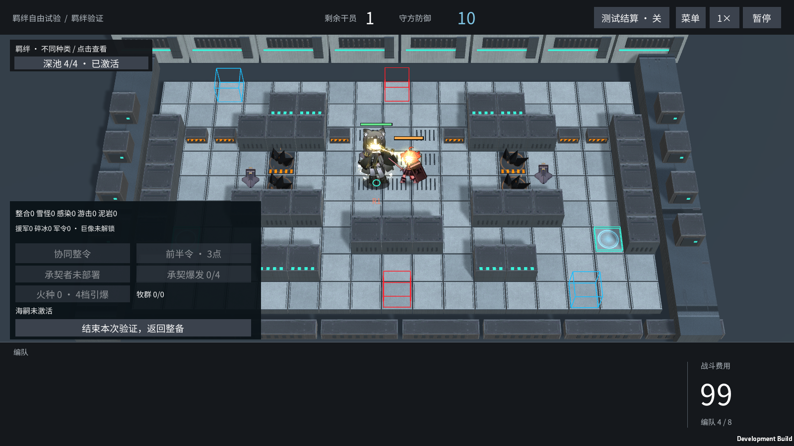
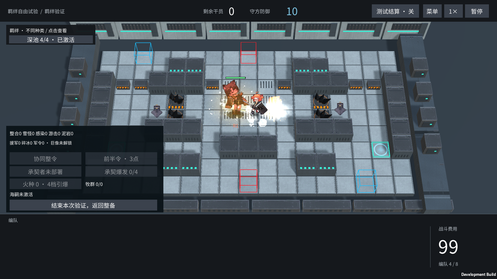

# 蔓德拉：原作特效与五费商店

2026-11-05，霍利屹。[任务 #67](https://github.com/Peanora/YesterdayConvoy/issues/67)。用户确认工程外 V1 预览后要求接入战斗与商店。功能分支 `codex/mandragora-vfx-preview`，基于 main `2c04ba7`。

[PR #69](https://github.com/Peanora/YesterdayConvoy/pull/69)已吸收后续main `a37f0e5`，保留塔露拉火雨V12与爱国者特效。最终集成结果见QA最新记录与本地BUILD-INFO。

## 怎样试玩

Unity 精确版本为 **6000.6.5f1**。本地 Windows 入口是 `Builds/Windows/YesterdayConvoy.exe`，保留整个 Windows 目录。

- **快速看角色**：主菜单进入羁绊验证，在整备面板选“深池样板”，关闭商店，开始下一次战斗，将蔓德拉拖到红门。该预置现在包含四名深池成员，原有四档羁绊可以实际凑齐。
- **正常招募**：三阶段挑战的商店按既有五费概率刷新蔓德拉；同名三张合成与出售沿用现有交易规则。六星后期两关演示的商店也开放蔓德拉。没有改动普通商店的等级概率或给她增加保底。
- **单怪**：`Assets/Scenes/MonsterTrial.unity` 选择蔓德拉，按原入口部署。

商店备战席沿用模型待机、购买落地和升星显示。普通流程不会自动强制切第二阶段，也不会凭空生成支柱；倒柱依赖地图已配置的有效支柱。当前 Campaign / BattleShop 地图没有新增支柱，本轮后期倒柱证据使用下述明确的开发夹具，不能视为新地图设施已制作。

## 接入了什么

原普攻起手 / 弹道 / 命中、凝视眼部光球 / 动态光束 / 目标命中、石盾 / 破盾 / 补盾、复起、二阶段悬浮范围、倒柱警告 / 四方向爆烟碎石、封地碎石和最终死亡。表现只读取实际战斗事件与模拟时钟，不另行扣血。

| 战斗事件 | 原动作与时点 | 实际驱动 |
|---|---|---|
| 一阶段普攻 | C1_Attack，原 OnAttack 0.833 秒 | 原起手随动作；爆点读 CombatShot.Applied / ImpactAt |
| 二阶段普攻 | C2_Attack_1 / _2，原 OnAttack 0.833 秒 | 起手读实际攻速；弹道按 StartedAt → ImpactAt；命中由实际结算控制 |
| 凝视 | C1/C2_Skill_1_Begin / Loop / End | 原 0.833 秒进入光束，眼睛取逐帧骨骼挂点；跟随实际目标，退场或中断立即断束 |
| 补盾 | C1/C2_Skill_2，0.733 秒标记 | begin 随恢复事件播放，常驻石盾在该视觉标记后显示；保留原逻辑即时恢复减伤的结算 |
| 倒柱 | C2_Skill_3，0.667 秒原动作标记 | cast 随指令，警告从真实指令计时；保留本作总计 5 秒预警，不额外延后伤害 |
| 复起 | Reborn，原长 7.333 秒 | 按本作 5 秒复起规则缩放动作和特效时钟，不延长保护或复活时间 |
| 破盾 / 死亡 / 封地 | 原对应素材 | 破盾读 StoneShieldBrokenAt；死亡读 DeathTime；封地读取真实 SealedTiles |

修正了原有二阶段动作互换：现在 **C2_Skill_2 是补盾、C2_Skill_3 是倒柱**。二阶段补盾的动作锁从误用的 1.333 秒改为原完整 1.5 秒；倒柱沿用既有 1.5 秒锁定，未缩短既有玩法间隔。普攻动作现在跟随实际攻速。

修正混编接入所需的参数读取：凝视、悬浮范围伤害、对空状态、柱击破盾使用该实例的角色配置；复起恢复该实例的升星生命，避免副卡蔓德拉继承主卡的生命和伤害。

五费试验基础值为生命 1000、攻击 110、防御 10、范围 1.5、间隔 1.8、移速 0.5、部署 10 DP、两次部署；法抗沿用原 M32 配置。二星 / 三星按现有五费成长公式，生命 1900 / 5000，攻击 187 / 330，部署 12 / 14 DP。这些是本作试验参数，未做长期平衡验收。其他未完成首领仍保持原准入边界。

## 素材、来源与适配

运行依赖均在 `Assets/Art/VFX/Mandragora/Resources/MandragoraVfx/`：**42 段、2595 帧、48 页 PNG**，原 PNG 约 15.2 MB，配清单、挂点和必要 `.meta`。复用已跟踪的 `MudrockVfx/OriginalEffect.mat` 与其兼容 Shader，使用预乘透明和加色 RGB；没有原始 AB、外部加工目录、联网或作者磁盘路径的运行依赖。

原角色为 `enemy_1523_mandra`；特效源版本 `26-10-29-15-36-11-33649006`。角色配置、弹道与原生粒子分别从官方清单精确定位的 `battle/enm_pfb_18.ab`、`pkgrps/btl_pfb_fx_enemy_7.ab`、`battle/prefabs/[uc]projectiles.ab`、`battle/prefabs/effects/stonepillar.ab` 取得。详见[资源版本、下载 URL、MD5 / SHA-256 与依赖记录](../art/source-records/mandragora-native.json)。原动作使用已有 M32 角色图集，不重复替换角色素材。

原生粒子、材质、纹理与动画在工程外用 Vulkan 烘焙，Windows 用兼容材质播放。原游戏脚本没有完整执行；UV 滚动按读取到的原字段驱动，光束长度、挂点、画面排序和本作时钟作了适配。循环截取两秒稳定片段，随机粒子序列不等同原游戏每次施放。原 `skill_03_pillar_01` 脚本容器在离线环境未产生非空画面，未装成空图集冒充完成；可见警告、落石和倒塌使用各自已渲染的原特效。本轮没有音效。

素材属于《明日方舟》原作媒体，公开再分发许可尚未确认。本次按用户接入要求及仓库现行持续交付约定随源码提交运行依赖；该上传授权不登记为权利人授权、原创、CC0 或 MIT。公开工具的许可与游戏媒体许可分别记录。原包和无关预览留在工程外。

## 实际验证入口

定向逻辑：`MandragoraEffectTests`、`MandragoraRosterTests`、相关 Campaign / 羁绊测试。真实 GPU：`MandragoraPresentationTests` 和相关商店、霜星、泥岩、羁绊场景。最终结果见 [QA](../QA.md) 最新条目。

Windows 开发构建可使用 `-mandragoraVfxSmokeTest -demoEvidenceDir <证据目录> -force-d3d11`。先走现有商店的满席购买合成、模型备战席和暂停拖动部署，再在同一实际地图相机中使用明确的开发战斗条件覆盖后期事件；会输出 `MANDRAGORA_VFX_CHECK` 并按结果退出。后期夹具固定位置、慢移速与高生命测试守军，通过原战斗伤害接口触发复起和破盾，不改变正常关卡配置。

逐项检查两阶段普攻的一次命中、凝视像素、暂停帧冻结、双实例各自的光束、目标退场断束、破盾中断、原补盾 / 倒柱动作、封地、死亡、重开清理。像素证据通过相同时刻关闭特效前后的相机输出比较，同时人工查看截图。全新克隆 / 第二台电脑、完整 13 关自然通关、人工长时经营和性能 / 强度平衡尚未验收。

