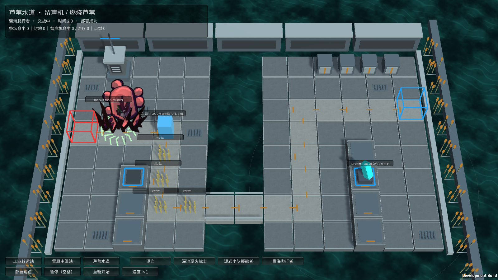
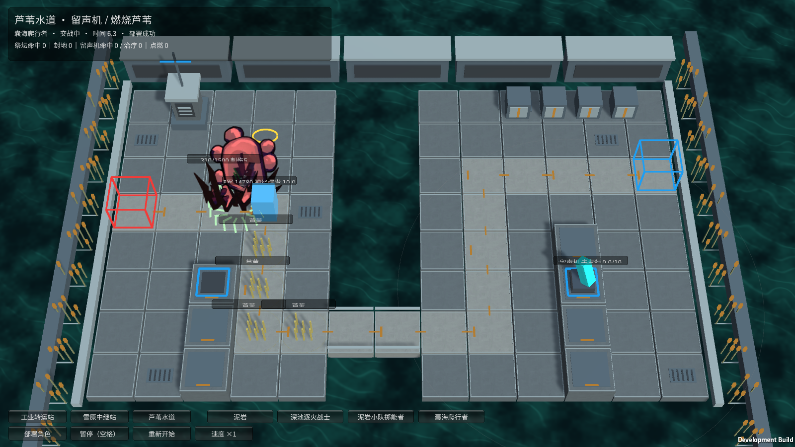

# M33 囊海爬行者：受伤刺伤与神经损伤

霍利屹 / Codex，2026-10-25。[任务30](https://github.com/Peanora/YesterdayConvoy/issues/30)、[PR27](https://github.com/Peanora/YesterdayConvoy/pull/27)。用户授权持续补齐已有模型效果，银狼暂缓。本轮仅补个人能力，不等于海嗣羁绊、永久成长或全部角色完成。

## 直接试玩

运行 `Builds/FacilityTrials/YesterdayConvoy-Facilities.exe`，选择芦苇水道 → 囊海爬行者 → 部署角色。守军正常射击会触发反击，绿色刺波为范围反馈；神经爆发后守军出现黄色标记和10秒倒计时，停止攻击/阻挡，爬行者继续走。无需按钮注入伤害。完整怪物入口 `Builds/Windows/YesterdayConvoy.exe` 也可选择M33部署，保留EXE同目录配套文件。

## 已实现

- 保持不进行普通攻击、没有弹药/SP主动技；不会因为附近有守军就停下来主动输出。
- 存活时受伤后，累计失血严格超过最大生命的15%、30%、45%等节点才反击。一次伤害跨过多个节点只触发一次，不延迟补齐多次；治疗不重置已越过的节点；致命伤不产生反击。
- 每次反击对半径2范围内所有存活守军造成攻击力100%的法术伤害和攻击力100%的神经损伤。范围效果不要求选中目标，因此也影响迷彩守军；不受普通攻击范围或护甲影响。
- 受现有支柱控制时跨节点会消耗判定但不补反击；普通沉默不额外禁用该强制反击。原作冻结、浮空等控制尚无面向所有怪物的完整入口，本轮不冒称已实现这些系统。
- 神经损伤使用本作缩放：累计100后造成100真实伤害并眩晕10秒，期间不再积累；护甲/法抗不减免这次真实伤害。原作1000累计/1000真伤按同一比例缩小，控制时长不缩短。
- 神经眩晕确实阻止守军发起攻击与阻挡，已经发出的普通弹道仍可落地；结束后恢复。普攻或环境伤害仍可继续降低处于爆发期守军的生命。
- 反击占用0.3秒停止移动的本作表现窗口，之后恢复原路线。暂停冻结反击、神经状态与画面；暂停时拒绝伤害变更。重开清空实体、失血节点、脉冲、神经累计和计数。

## 动作与配置

M33现有原图集只有待机、行走、死亡，没有原刺伤片段；本轮明确用程序刺波表现反击，不伪造或宣称已有原攻击动画。保留原造型、帧和GUID，继续走原动画，角色不会出现普通攻击状态。

完整配置把仅供占位的攻击1改为30用于反击、护甲6改为0；无普通攻击开关保留。独立设施试验生命1500、守军生命15000/攻击170/阻挡3，使自然交战能展示足够反击与神经爆发。这些是试验缩放值，未改其他角色的数值。

依据[原始enemy_1152_dsurch数据](https://github.com/Kengxxiao/ArknightsGameData/blob/master/zh_CN/gamedata/levels/enemydata/enemy_database.json)的15%判定与1倍伤害/神经比例，以及[囊海爬行者说明](https://prts.wiki/w/囊海爬行者)中的半径2、强制触发和单次跨阶段规则。[元素规则](https://prts.wiki/w/元素)用于区分法术伤害、真实伤害和神经眩晕，不混入对敌元素伤害/麻痹的另一套效果。

## 验证与交接

Unity6000.6.5f1：136/136 Edit通过，46/46完整GPU Play通过，零失败零跳过；最后补充范围反击可命中迷彩的断言后，定向实际场景1/1再次通过。覆盖严格阈值、单次跨阶段、致命伤、治疗、控制抑制、范围/法抗、真实伤害、眩晕阻挡、爆发期间不重复积累、暂停/重开和实际原帧。

独立设施Player退出0：retaliation/neural/noOrdinaryAttack/noInjectedDamage为True，自然5次刺伤、1次神经爆发，部署/效果/暂停/重开全部True。完整M33入口退出0：正常部署、暂停、受击、单只结算、三只突破、胜负与返回清理均True，attacked=False/canAttack=False/policy=True符合无普攻规则，不把反击写成普通攻击。

Windows设施构建732,282,114字节，完整入口846,333,322字节，0错误。证据在本机artifacts/m33-*；截图随说明保存。尚未在第二台电脑、人类完整关卡或长时性能下验收。

M33原媒体目录10项图集/清单/meta均已跟踪，运行依赖不被忽略，未新增原PNG、未更换GUID。新脚本/测试meta与截图随源码。原素材权利状态保持真实，不改标CC0；本轮不声称另获许可。主场景/共享Prefab/Packages/ProjectSettings不改，缓存/日志/构建/AGENTS/.vscode不提交，不自动合并、发ZIP或Release。

