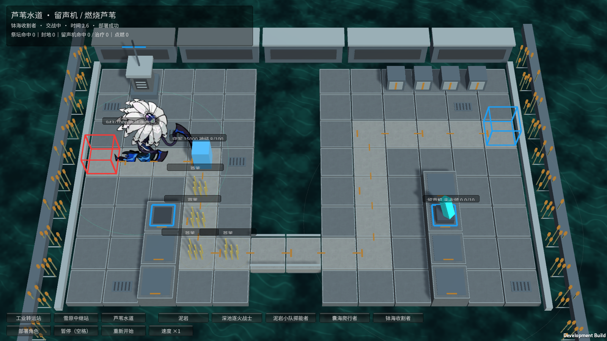
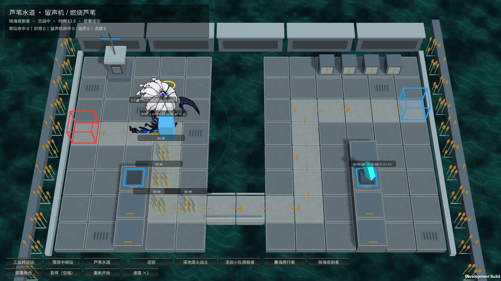

# M34 钵海收割者：待命、苏醒与临战

霍利屹 / Codex，2026-10-25。[任务31](https://github.com/Peanora/YesterdayConvoy/issues/31)、[PR27](https://github.com/Peanora/YesterdayConvoy/pull/27)。继续已有模型效果，银狼暂缓。

## 怎么试玩

运行 `Builds/FacilityTrials/YesterdayConvoy-Facilities.exe`，芦苇水道 → 钵海收割者 → 部署。守军的真实攻击使其苏醒，随后可观察临战移动/待机、近战、绿色范围环、生命流失和神经爆发；守军眩晕后收割者继续行走。整个过程没有注入生命、手动改阶段或强制释放效果。

完整怪物入口 `Builds/Windows/YesterdayConvoy.exe` 也能选M34。该只试玩将低伤守军布置在入口附近，每只被正常击伤后苏醒，按正常规则可连续部署三只。无受击时的30秒待命另有模型测试，不把入口快速苏醒冒充展示过完整30秒。

## 机制

- 初始待命，不普攻；出场前30秒不移动。若始终未受伤，30秒后仅以基础速度缓慢行走，仍不主动攻击。
- 生命严格低于99.99%时播放1秒原苏醒动作，然后永久进入临战。恢复满血也不退回待命。现有支柱控制期间会等待控制解除再开始苏醒。
- 临战移动速度增加500%，即基础速度的6倍；每秒流失自身最大生命的4%，没有治疗时约25秒自然耗尽生命，不变成复活或另一条命。自耗继续计入真实生命损失，但不会持续触发受击闪红，外部攻击仍正常闪红。
- 临战每秒对2.5范围所有守军积累相当于攻击力20%的神经损伤，包含迷彩守军；光环本身仅积累神经，满值时才爆发真实伤害。
- 被阻挡时进行物理近战，普通命中额外积累10%攻击力神经损伤。该值随弹道快照，在真实命中时结算；施法者/目标倒下取消未命中效果。
- 复用M33的缩放神经规则：累计100后100真实伤害、眩晕10秒，期间不重复累计，守军暂停攻击和阻挡。临战期间被现有控制限制行动时，自耗和被动光环继续结算。
- 暂停冻结苏醒、移动、光环、自耗和动作；重开恢复待命、初值、空弹道和空神经状态。加速移动仍会被已生成废墟阻住。

## 造型与参数

启用已跟踪的 `extra_skill_begin`、`extra_skill_idle`、`extra_skill_move` 原片段：1秒苏醒、临战待机、临战移动。物理攻击和死亡使用原基础片段。没有改原帧、造型或GUID；范围环/眩晕标记为程序反馈，不称为原作完整VFX/声音。

依据原 `enemy_1151_dslntc` 基础型数据的30秒自缚、99.99%门槛、移动+500%、生命4%/秒、神经20%/10%比例，参考[原始数据](https://github.com/Kengxxiao/ArknightsGameData/blob/master/zh_CN/gamedata/levels/enemydata/enemy_database.json)及[钵海收割者](https://prts.wiki/w/钵海收割者)。未混用另一个同名活动变体。

本作基础移动0.15，临战0.9；攻击40、护甲8、法抗75、普攻间隔3秒。独立设施试验生命1000，守军生命15000/攻击4/阻挡3；完整入口保留原生命260，专用守军位置(-4,1)、攻击1/范围1.2、阻挡0，用实际命中依次唤醒入场单位。这些是本作展示参数，不是原版克洛丝数值，也没改其他角色的守军配置。

## 验证

Unity6000.6.5f1：最终148/148 Edit通过，47/47完整GPU Play通过，零失败零跳过。最后修正自耗不应连续刷新受击闪红，增加对应断言后，定向M34场景1/1再次通过。涵盖30秒、严格门槛、唯一苏醒、6倍移动、4%自耗/自然死亡、迷彩光环、神经爆发、阻挡近战附伤、未命中取消、治疗、暂停/重开和加速废墟碰撞。

最初把远处守军用于唤醒多只，守军持续攻击首只，第二只留在入口，导致第三次部署不合法。修正了这只角色的正常试玩布置，并给自动验收足够苏醒/离开入口的3.3秒间隔；仍要求三次真实合法部署，没有绕过入口判定。完整入口无阻挡守军不会触发物理近战，回归明确检查临战自耗和实际神经光环；近战附伤由独立设施与模型验收。

最终Windows设施732,289,385字节、完整入口846,340,534字节，0错误。独立设施Player退出0，waking/combat/aura/neural/noInjectedHealth和部署/暂停/重开全部True，观察到自耗454。完整入口M34 Player正常部署、受击、结算、三只部署突破、胜负和清理通过，实际临战和光环输出符合规则。日志/截图原件在本机artifacts/m34-*。

M34媒体目录101项图集/清单/meta均已跟踪，运行依赖不被忽略；新增脚本/测试meta和实机图随源码。原素材权利记录保留，不改标CC0或声称新增许可。主场景/共享Prefab/Packages/ProjectSettings未改，缓存/日志/构建/AGENTS/.vscode不提交，无ZIP/Release或自动合并。

仍未做正式混编、完整控制/元素抗性、全部原VFX声音、第二台电脑验收；已有角色效果继续往下，不把海嗣羁绊成长一并算作完成。

