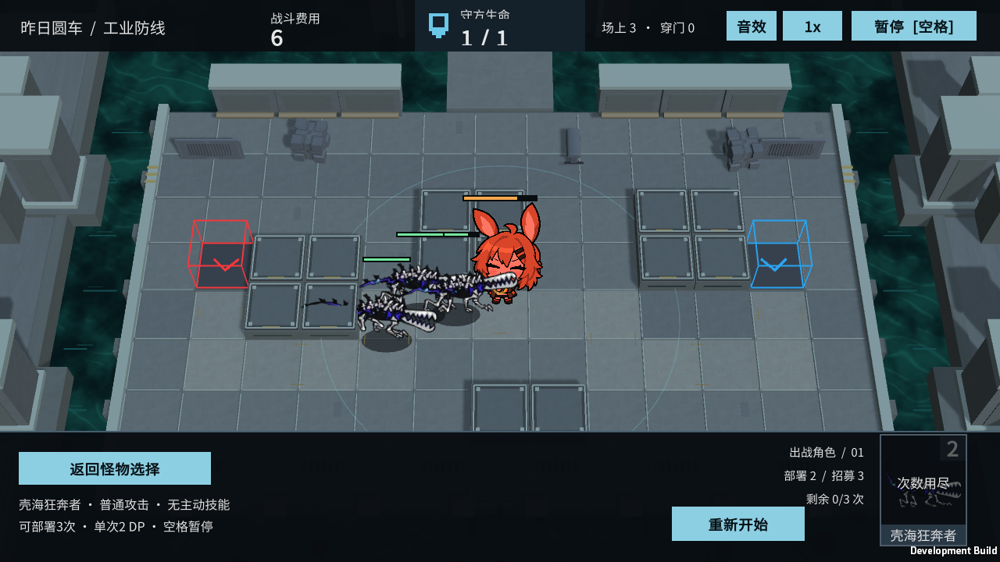

# M35 壳海狂奔者：基础效果复核

霍利屹 / Codex，2026-10-25，任务 #32 / PR #27。

原型号 enemy_1147_dshond 没有个人天赋或技能，保留已有物理近战、行走、受击、死亡和突破，不添加神经附伤、待命唤醒或成长羁绊。参考原始 enemy_database.json 与 https://prts.wiki/w/壳海狂奔者；型号和原媒体来源沿用 docs/art/source-records 与 M21-M38-INTEGRATION。

本轮在源码 f765017 构建的完整 Windows 入口选择 M35 实际运行，Player退出0：正常部署、暂停、真实普攻、受击、单只结算、三只合法部署、突破获胜和返回清理全部True，canAttack/policy=True。日志 artifacts/m35-player.log；攻击实机图如下。原始四段动作和必要meta已随仓库跟踪，本轮无素材或机制改动。此前最终完整GPU Play 47/47包含该角色，未把既有结果声称为本轮新跑Unity。纯文档/证据补齐，无需重新构建；原素材权利状态不变，第二台电脑验收未执行。

试玩：Builds/Windows/YesterdayConvoy.exe → 壳海狂奔者。不要仅复制EXE；保留完整同目录文件。重新构建使用Unity6000.6.5f1与BaselineTools.BuildWindows。

