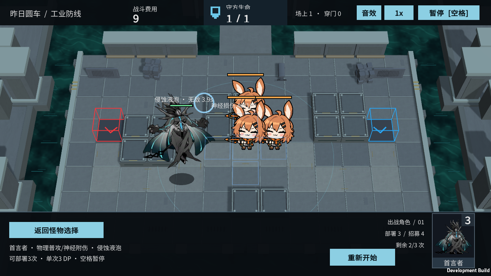
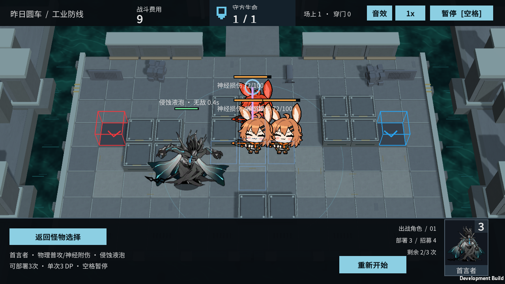

# M36 首言者：神经附伤与侵蚀液泡

霍利屹 / Codex，2026-10-25，任务 #32、PR #27。继续已有模型角色效果，银狼暂缓。

## 怎么试玩

运行完整目录中的 Builds/Windows/YesterdayConvoy.exe，选“首言者”并部署。普通攻击积累神经损伤；约出场10秒后释放液泡，施法原动作依次起手、循环、收势。蓝色液泡飞向锁定位置，十字地块与短射线提示逐次命中，守军满神经后眩晕并停止攻击/阻挡。暂停和重新开始按正常入口操作。

M36独立试玩保留三名相邻守军，以展示液泡分配；不是正式异构干员阵容。M35/M37原型号没有个人特殊技能，本轮另有实际基础战斗复核，分别见 M35-BASELINE-VERIFIED.md、M37-BASELINE-VERIFIED.md。

## 实际规则与连接

- 普通攻击修正为物理伤害，命中额外积累40%攻击力神经损伤；附伤随真实弹道快照，未命中/已失效目标不会凭空受损。
- 出场10秒首次就绪，范围2.5内有正常可选守军才释放。施放5秒期间不移动、不普攻、无敌；现有支柱也不能在保护期间造成伤害或控制。当前守军没有不同仇恨等级，初始目标沿用正常阻挡优先/最近目标的选择，平局顺序稳定，不声称已做异构仇恨系统。
- 下一次施放在本次5秒施放结束后冷却20秒。各实体独立计时，暂停冻结；无目标时等待，不凭空发射。
- 液泡锚定初始目标地块及上下左右四格，不是半径4。3秒后首次结算，此后每0.5秒一次，共5次；每次重新选该十字范围内神经损伤积累最少的存活可选守军，已处于神经爆发的单位优先级较低，无其他目标时仍可承受物理部分。
- 每次造成60%攻击力物理伤害及60%攻击力神经损伤。初始目标倒下不删除锚点，后续可打十字内其他目标；范围外和对角格不受此液泡影响。没有正式移动守军，液泡表现为到静态锚点的程序轨迹，不宣称复刻全部原弹道/寿命细节。
- 复用M33的本作缩放：神经累计100后100真实伤害，眩晕10秒，期间不再累计。回合重开/返回清除液泡、目标记录、弹道和元素状态。

FirstSpeakerEffects负责逐实体施放和独立液泡事件；EngagementCombat在真实普攻命中时结算附伤；NeuralEffects统一处理神经爆发。默认关闭的新字段只由M36开启。DemoSpriteVisual接入原ExtraClips的skill_begin/loop/end三段，NeuralEffectView只读取时钟和结果画提示，不负责伤害。原Attack_2片段仍保留，不把未接入的近战变体标为新技能完成。

本作缩放攻击60、护甲5、法抗20、普攻范围2.5/间隔3秒，守军生命650/攻击6，M36生命400、移动0.7保留；这套试玩参数不当作原作完整数值或最终平衡。此前误用法术普攻与1.8秒间隔已纠正，仅改M36配置。

## 来源、验证与交接

核对原始 enemy_1154_dsmant 基础型的物理远程、普攻40%神经、Spear初始10/冷却20/持续5/伤害比例60%。原始参考：https://github.com/Kengxxiao/ArknightsGameData/blob/master/zh_CN/gamedata/levels/enemydata/enemy_database.json ，规则交叉参考：https://prts.wiki/w/首言者 。图集来源沿用docs/art/M21-M38-INTEGRATION.md及原source-records，原图和GUID无修改，不改标CC0或新增许可。

Unity6000.6.5f1：155/155 Edit、48/48完整GPU Play通过，零失败零跳过。覆盖真实物理/神经命中、首次/周期冷却、无敌窗口、3秒延迟与五跳、最少积累重选、十字/对角排除、目标死亡、默认关闭、暂停/重开；实际场景自然播完三段动作并命中不同目标，未注入状态。最后仅修正特效排序/位置及去掉无关条件，Windows重新构建并实机复核，没有把之前隐藏的液泡画面当成通过截图。

最终完整Windows846,348,794字节，配套设施732,297,630字节，均0构建错误。最终M36 Player退出0：起手/循环/收势/液泡命中全True，命中3个不同守军、5次神经爆发；部署/暂停/真实普攻/受击/单只结算/三只部署/突破获胜/返回清理全True。日志本机artifacts/m36-*；下图为最后一次实际Player。M36媒体39项清单/图集/meta已跟踪，不被忽略；新代码/meta/实机图随仓库。

源码在codex/monster-deep-pool-effects、PR27，完整构建来源见各Builds目录SOURCE.txt；接收者用精确Unity6000.6.5f1拉取此分支，BaselineTools.BuildWindows构建完整入口。保留全部构建文件，不只复制EXE。第二台电脑、人类完整键鼠通关与长时性能尚未验证；正式混编/成长羁绊、完整通用控制/元素抗性、原版VFX/声音未在本轮实现。主场景/共享Prefab/Packages/ProjectSettings不改，无ZIP/Release或自动合并。

