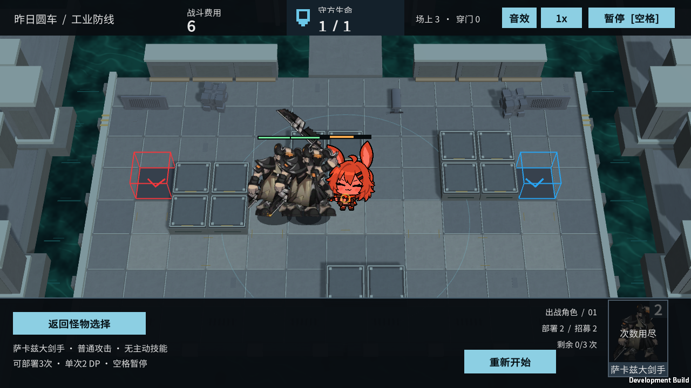

# M37 萨卡兹大剑手：基础效果复核

霍利屹 / Codex，2026-10-25，任务 #32 / PR #27。

原模型 enemy_1010_demon 是普通萨卡兹大剑手，无个人特殊能力。保留物理近战、自然行走、受击和死亡，不套用萨卡兹魔剑士的待命/激活或其他型号机制。参考原始 enemy_database.json 与 https://prts.wiki/w/萨卡兹大剑手；沿用 docs/art/M21-M38-INTEGRATION.md 的模型与来源记录。

本轮在源码 f765017 构建的完整Windows入口运行M37，Player退出0：正常部署、暂停、实际普攻、受击、单只结算、三只合法部署、突破获胜和返回清理全部True，canAttack/policy=True。日志artifacts/m37-player.log，实机图如下。此前47/47完整GPU Play包含该角色，本轮无新Unity测试、代码或素材改动，无需重建。已有基础四段图集与额外片段/meta保持，不将没有对应玩法的额外动作标为已实现技能。原素材权利记录不变，正式羁绊/构筑和第二台电脑验收另做。

试玩：Builds/Windows/YesterdayConvoy.exe → 萨卡兹大剑手。保留整个构建目录；接收者用Unity6000.6.5f1与BaselineTools.BuildWindows重新构建。

