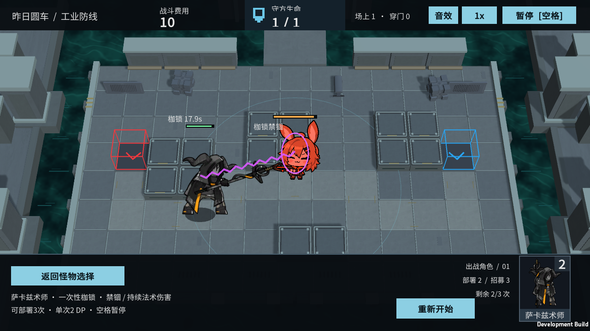
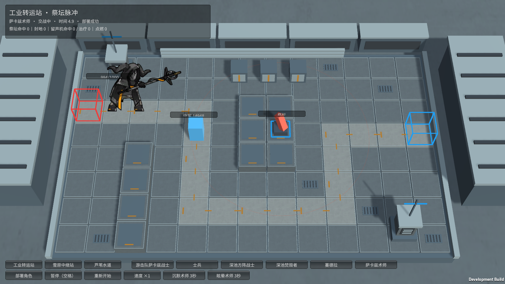

# M38 萨卡兹术师：一次性枷锁

霍利屹 / Codex，2026-10-25，任务 #33 / PR #27。继续已有模型角色自身效果，银狼暂缓。

## 试玩

完整入口：Builds/Windows/YesterdayConvoy.exe → 萨卡兹术师 → 部署。3格内出现可选守军后自动枷锁，紫色锁链/束缚环和文字显示禁锢。原动作起手0.8667秒、循环、结束0.6667秒实际接入。持续施法最长20秒，随后恢复普通法术攻击和移动，每只一场仅一次。

中断试验：Builds/FacilityTrials/YesterdayConvoy-Facilities.exe → 工业转运站 → 萨卡兹术师。部署后按“沉默术师3秒”或“眩晕术师3秒”，守军立即解除禁锢、恢复攻击/阻挡；控制过去不会重施枷锁。这是独立设施里的真实能力控制入口，不是假按键改伤害数字。完整角色样板没有额外沉默按钮。

## 已实现

枷锁选择3范围内存活、可选、未被神经爆发/冻结/其他枷锁控制的守军。本作守军静态且无飞行/异构仇恨等级，使用最近目标稳定选择，不宣称实现正式干员全索敌规则。绑定期间术师原地持续施法、不普攻；目标不能新发射普通攻击或阻挡，已发射弹道不凭空消失。守军当前没有可手动释放技能或移动功能，未把这些不存在的功能当作额外完成。

每秒一次35%当前攻击力法术伤害，正常扣法抗、不扣物理护甲，共最多20次；目标倒下、术师倒下、沉默/眩晕及实际支柱控制均结束，剩余伤害取消。不跳转另一个目标，不退还本次使用次数。施放前被沉默只延后首次枷锁，不提前消耗。解除枷锁只解除本能力，已有其他神经/冻结控制仍按各自时钟。暂停拒绝新控制并冻结时长，重开清空事件和次数。

ShacklerEffects负责逐实体事件与一次性限制，EngagementCombat用DefenderShackled决定真实阻挡和攻击；DemoSpriteVisual读事件播放原skill_begin/loop/end，NeuralEffectView程序连线仅表现结果。新字段默认关闭，仅M38开启，普通攻击仍法术。独立参数攻击50、护甲2、法抗50、射程2.5/间隔4秒；完整样板守军生命700保证单只完整展示20秒。设施沿用生命1000/守军15000试验框架，不把这些当作原版完整数值。

## 证据与来源

原型enemy_1022_dmage基础型，核对原始lasso字段hit_duration20、atk_scale0.35、range_radius3.0及[规则说明](https://prts.wiki/w/萨卡兹术师)。原数据参考[enemy_database](https://github.com/Kengxxiao/ArknightsGameData/blob/master/zh_CN/gamedata/levels/enemydata/enemy_database.json)。沿用docs/art/M21-M38-INTEGRATION.md和原来源记录；53项媒体/清单/meta已经跟踪，不改原图、GUID或权利状态，不改标原创/CC0。

Unity6000.6.5f1：165/165 Edit、49/49完整GPU Play通过，零失败零跳过。包括伤害/法抗、20秒释放、单次限制、真实支柱控制、沉默/眩晕、施法者/目标死亡、预先沉默、暂停/重开与默认关闭；实际场景自然起手/循环、按钮中断后原收势、守军恢复攻击和只施放一次均通过。

Windows完整入口846,361,054字节、设施732,309,893字节，0错误。三个实际Player退出0：

- 设施自然路径：20次/350真实扣血，禁锢期间没有新守军攻击，解除/一次/暂停/重开全部True。
- 设施沉默路径：实际按钮在3次/52.5扣血后中断，守军恢复攻击、术师恢复普通攻击、无第二次枷锁，全部True。
- 完整入口：三段原动作、20次/一次施法、部署/暂停/受击/普通攻击/单只结算/三只部署突破/胜负/返回清理全True。

日志原件artifacts/m38-*；下图为本轮实际Player。源码与必要meta/实机图随codex/monster-deep-pool-effects提交、PR27审查；各Builds/SOURCE.txt记录源码。接收者使用精确Unity6000.6.5f1和BaselineTools.BuildWindows/FacilityTrialTools.Build构建并保留整个输出目录。

独立工业场景只追加M38引用，主场景/共享Prefab/Packages/ProjectSettings未改。未第二台电脑、人类完整键鼠通关或长时性能；未做正式混编、守军技能/移动/飞行、通用完整控制系统及原版完整VFX/声音。无ZIP/Release或自动合并。

