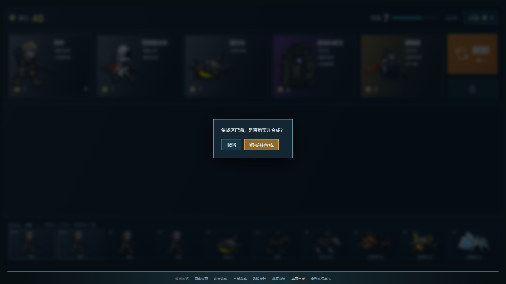
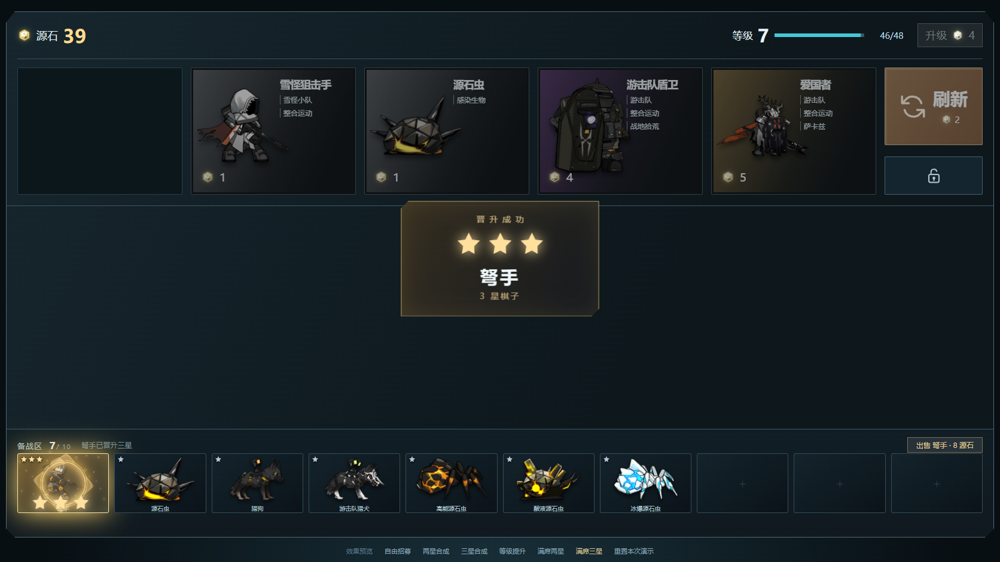

# 商店 v12：上方商店、下方备战与地图试玩

2026-10-30 · 霍利屹 · [任务 #41](https://github.com/Peanora/YesterdayConvoy/issues/41)、[地图接入 #48](https://github.com/Peanora/YesterdayConvoy/issues/48) · [PR #47](https://github.com/Peanora/YesterdayConvoy/pull/47)

最新Unity试玩已改为大地图、可开关覆盖式商店和扁平备战席，按Tab展开/收起，见[操作说明](../../SHOP_MAP_TRIAL.md)。本目录浏览器保留v12固定上下布局作为历史展示，不冒充最新Unity交互。

商店移到屏幕上方，10格备战席放在底部。购买直接点人物图片，费用用背景色区分，锁定使用锁形图案，角色下面显示羁绊。升星新增屏幕中央大星标、角色名与“晋升成功”；连锁三星只播最终三星，不先播一次两星。

## 先试玩

浏览器：保留整个目录，双击 `open-preview.cmd`，自动使用 Chrome 或 Edge；也可直接打开 `index.html`。默认两星材料，底部可切自由招募、三星、升级、满席两星、满席三星或重置。无需服务器和网络。

Unity：本轮新增独立 `Assets/_Game/ShopTrials/ShopMap.unity`，中间使用已有“泵站回廊”地图。Unity 6000.6.5f1 打开后点 Play；Windows 构建、操作和范围见[地图试玩说明](../../SHOP_MAP_TRIAL.md)。原有主场景、地图配置和 Prefab 未改。

| 演示 | 操作和结果 |
| --- | --- |
| 两星 | 购买第三张一星，汇聚成一张两星，中央显示一次大提示。 |
| 连锁三星 | 两张二星与两张一星，再买最后一张，直接展示最终三星。 |
| 满席两星 | 10格已满，购买可合成牌先确认；确认后剩9格，只扣一次费用。 |
| 满席三星 | 10格已满，确认连锁后剩7格，得到一张三星；无法合成的购买被拒绝。 |
| 升级 | 4源石换4经验，溢出保留，当前五张不变；下次刷新按新等级抽取。 |
| 刷新 | 2源石，五张依次入场；锁店不刷新、不扣费。 |

出售：按住备战棋子向屏幕最下方拖，进入下沿出售区后松手。显示角色、星级和到账源石。拖回、区外松手、Esc、指针取消和失焦均取消；轻点只选择。出售区已随备战席移到底部，商店不再充当出售目标。

## 规则与边界

遵守 [GDD第7节](../../GDD.md) 和 [SHOP-v0.1](../../proposals/SHOP-v0.1.md)：五格、每种9张基础牌、10格备战、三张同种同星合成、最高三星。1/2/3星分别占库1/3/9张，出售回款 c/3c−1/9c−1 并返库1/3/9张。满席可合成时先确认，无可合成或钱不足时状态不变。锁定、重复购买、缺货和已持有三星不会额外扣款或造牌。

升级试验曲线：1至9级需求2、4、6、10、20、32、48、70、90，最高10级。演示中的钱、材料与经验是测试预置，不是正式开局。浏览器含38个已有图像角色；Unity试玩只接入现有编队适配器兼容的10种基础角色。未实现战后收入、通关经验、存档、羁绊属性及星级战斗属性成长。

`shop-model.js`负责库存和交易，`shop.js`负责动画，`sell-drag.js`共用同一出售报价。一次交易仅有一次最终晋升。减少动态效果时跳过运动，结算不变。

## 素材与实际验证

角色原路径及哈希见[role-sources.json](role-sources.json)，取自工程快照 `7ec2860c398b692d73527c3533dd8affa40c1ecf`；M02～M10为待机首帧按透明边界裁切，其他用已有立绘。[羁绊映射](synergies.json)中的“战地拾荒”等仍只是讨论标签，没有属性效果。

源石使用[PRTS收录的原游戏PNG](https://prts.wiki/w/文件:图标_源石.png)，原像素未改。来源、SHA256和Unity运行路径见[记录](assets/originium-source.json)。PRTS是社区站；未收到公开再分发授权文件，按用户持续上传指令随源码保存，不把学生作业用途记成权利人授权。角色沿用工程已有来源记录。光效使用本作CSS或Unity绘制，没有提取参考游戏UI动画或音效。

本轮 Node 7/7通过；Chrome离线实测上下布局、满席两星/连锁三星、取消不扣款、中央晋升提示、底部出售，无页面错误。截图为本轮1672×941实际页面。Unity完整276 EditMode、74 GPU PlayMode通过，Windows和独立Player结果另见[地图说明](../../SHOP_MAP_TRIAL.md)。

历史 `effects.webm`、`merge-effects.webm`、`sell-effects.webm` 和旧两星/升级/出售截图保留供比较，展示的是v11旧布局，不代表v12当前位置。未在第二台电脑或Edge实测。
