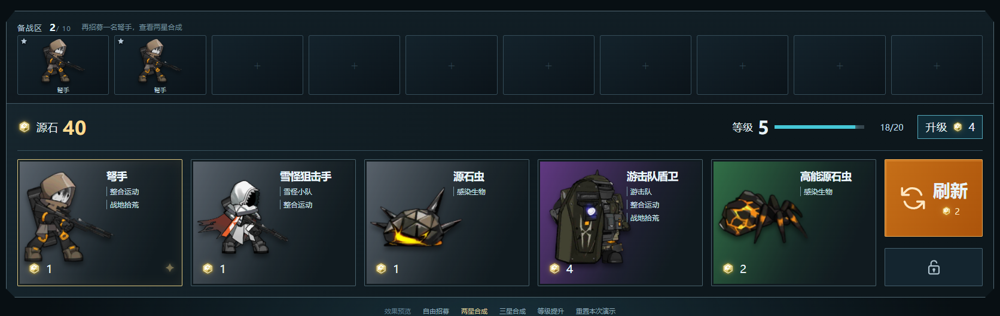

# 底部商店 v9：升级、升星与刷新

2026-10-30 · 霍利屹 · [任务 #41](https://github.com/Peanora/YesterdayConvoy/issues/41) · [PR #47](https://github.com/Peanora/YesterdayConvoy/pull/47)

在已确认的v8界面上，补充可操作的升级、合成和刷新效果。仍是工程外浏览器预览，尚未接入Unity正式商店、编队、战斗或羁绊结算。

## 怎样看

下载本分支，保留整个目录，双击 `open-preview.cmd`（Chrome优先、Edge其次），或把 `index.html` 拖进浏览器。无需Unity、Node或服务器，素材离线可用。默认“两星合成”，页面底部切换演示或重置。

| 演示 | 操作与结果 |
| --- | --- |
| 两星合成 | 已备两张一星弩手，购买第三张：卡片飞入、材料汇聚、冷白光和两星亮起。 |
| 三星合成 | 已备两张二星与两张一星，购买最后一张：先合二星，再连锁三星，金色光环、粒子和三星亮起。 |
| 等级提升 | 点击升级，扣4源石、加4经验；经验满后提升等级、播放光效并保留溢出经验，当前五张不变。 |
| 自由招募 | 从1级、32源石与一张随机低费赠卡开始，可正常购买、刷新、升级、升星和出售。 |

刷新消耗2源石，五张卡依次淡出、上移入场；锁店时不刷新、不扣费。购买仍直接点击人物图片，不添加招募按钮、已购文字或车队标题。羁绊、费用背景色、源石图标与锁形按钮保留。点击备战棋子可选择出售。

[实际操作录像](effects.webm) · [两星](two-star.png) · [三星](three-star.png) · [升级](level-up.png)

## 规则与范围

遵守工程 [GDD第7节](../../GDD.md) 和 [SHOP-v0.1](../../proposals/SHOP-v0.1.md)：五格、每种9张基础牌、10格备战、三张同种同星自动合成、最高三星；1/2/3星分别占库1/3/9张。展示占库，购买不重复扣库，刷新先返还未购买牌，按等级费用概率和剩余库存抽取。持有三星后不能再刷到该角色。售出回款c/3c−1/9c−1，返库1/3/9张。

钱不足、已购买空格、满仓无法合成、锁店与合法档缺货均不扣款。满仓但购买可合成时先确认“购买并合成”。动画期间禁止重复命令。升级保留当前五张，下次刷新才使用新概率，最高10级。开启“减少动态效果”时跳过运动动画，结算照常。

试验参数：4源石买4XP，1至9级升级需求为2、4、6、10、20、32、48、70、90。演示预置材料、等级与经验，便于看效果；不是正式开局和最终平衡。不实现通关经验、战后收入、正式编队、存档、升星后的战斗属性。队伍等级只预览等级/编队上限数值；羁绊仅显示标签。

## 文件与来源

`shop-model.js`处理库存、等级与交易；`shop.js`连接交互和动画；`shop.css`绘制界面与特效。`roster-data.js`内嵌38个已有角色PNG与羁绊表；源石原图位于assets。预览不读取其他工程或网络。原v8可从Git历史查看，本机旧预览也保留。

角色原路径与PNG哈希见 [role-sources.json](role-sources.json)，取自工程快照 `7ec2860c398b692d73527c3533dd8affa40c1ecf`。M02–M10仍取待机首帧并按透明边界裁切，其余为已有立绘。[羁绊映射](synergies.json)含41条设计、实际图像38个；M07/M08/M17/M18/M22“战地拾荒”仍为讨论标签，无属性效果。

源石使用 [PRTS收录的原游戏PNG](https://prts.wiki/w/文件:图标_源石.png)，52×53，像素未改；见[来源与哈希](assets/originium-source.json)。PRTS是社区站，非权利人官方托管。保留原作权利记录，未取得新的公开再分发授权文件；按用户明确上传指令提交，不把作业用途记为授权。

参考卫戍协议的工业界面与招募反馈，以及云顶的合成提示、刷新节奏和升星层次；新光效由本项目CSS和浏览器动画制作，没有提取参考游戏的UI动画、音效或特效贴图。参数采用本工程规则，不冒称当前参考游戏参数。[卫戍协议入口](https://prts.wiki/w/卫戍协议)、[官方活动说明](https://ak.hypergryph.com/news/8584)、[TFT官方界面效果改进](https://followthefix.teamfighttactics.leagueoflegends.com/)。

## 实际验证

Node内置测试6项通过：九张库存与连锁三星、锁定/重复购买/钱不足不变状态、经验溢出且保留商店、禁止未解锁费用、满仓原子交易及确认、100个种子的连续交易守恒。开发者在本目录运行 `node --test tests/shop-model.test.cjs`，无需额外npm依赖。

Chrome离线实测通过：两星/连锁三星动画、升级保留五张并结转2XP、快速连点不重复扣款、锁定、刷新、重置和减少动态效果；无页面脚本错误或外部请求。1672×530、1366×768、1920×1080、390×844布局可用；截图和录像来自实际页面。仓库静态检查结果见PR。

未运行其他电脑、Edge实测或Unity编译/构建。本次无Unity代码或资源导入改动。
